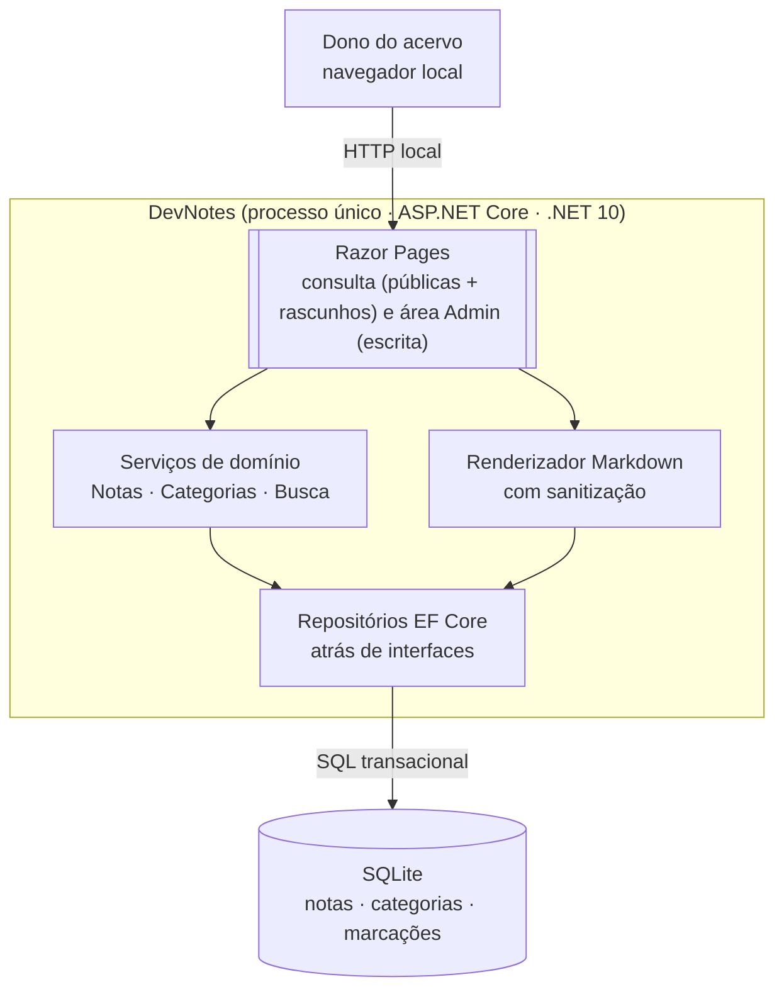

# Proposta Arquitetural — DevNotes

> Cliente: interno (projeto pessoal) · Documento gerado em 24/10/2026 · Versão 0.1

## 1. Sumário executivo

Estamos construindo o **DevNotes**, um caderno pessoal de referência técnica em C#/.NET, desenvolvimento de software e IA agêntica: notas escritas no próprio app, organizadas por categorias, encontráveis em segundos.

A arquitetura proposta é um **monolito modular único — uma aplicação Razor Pages com banco SQLite** — porque o problema é pequeno (uso pessoal, dezenas a centenas de notas) e a prioridade é achar rápido e evoluir sem transtorno. A simplicidade agora é o que preserva a possibilidade de crescer amanhã: notas públicas para visitantes e administração protegida por login já estão separadas no desenho, sem se pagarem hoje.

O principal risco é o oposto da over-engineering: plantar complexidade que uso pessoal não justifica. Mitigamos decidindo pelo software mais simples que atende cada meta concreta — e documentando quando cada dívida plantada vira problema.

Esta proposta não estima custo, esforço nem cronograma.

---

## 2. Contexto e objetivos de negócio

### 2.1 Problema

O conhecimento técnico acumulado (C#/.NET, desenvolvimento de software, IA agêntica) está espalhado entre anotações avulsas e fica lento de recuperar na hora em que importa — ao codar, estudar ou responder a uma dúvida. A dor declarada é **achar rápido**: o valor central é busca e organização, não armazenamento bruto.

### 2.2 Objetivos de negócio

- Registrar conhecimento técnico em notas Markdown escritas no próprio aplicativo, com organização por categorias
- Encontrar qualquer nota em segundos, durante o trabalho (navegação e busca são o fluxo central)
- Manter o conteúdo seguro contra perda (o banco é o item mais valioso do sistema)
- Preservar o caminho para o estado futuro: consulta pública de notas publicadas por visitantes, administração restrita a administradores autenticados

### 2.3 Não-objetivos

- Autenticação nesta primeira etapa (decidido, com separação preservada na arquitetura — ADR-004)
- Colaboração entre usuários nesta fase
- Integrações externas (GitHub, Obsidian, serviços de IA) nesta fase
- Sincronização multi-dispositivo (sem dor declarada nesta fase — registrada como dívida consciente, seção 9)

### 2.4 Usuários e cargas esperadas

- **Agora**: um único usuário (o autor), acesso local. Ordem de grandeza de notas: dezenas a centenas em 1–2 anos. Carga trivial — sessões de leitura/escrita intermitentes.
- **Futuro (fora do escopo desta fase, mas dirigindo decisões)**: visitantes anônimos consultando notas publicadas; administradores autenticados criando/editando/excluindo.

---

## 3. Atributos de qualidade prioritários

### 3.1 Performance de busca e navegação (o "achar rápido")

- **Meta concreta**: busca por texto e navegação por categoria retornam em p95 < 200 ms com 1.000 notas locais — **alvo a verificar por medição, não resultado já comprovado**
- **Por quê**: é a dor declarada — se achar for lento, o caderno não substitui as anotações avulsas
- **Como a arquitetura atende**: banco local SQLite com consulta indexada, sem camada de rede; teste de busca entra desde a primeira tarefa de implementação
- **Critérios de medição** (definidos aqui para a medição ser reproduzível):
  - **Banco de referência**: ~1.000 notas com títulos e conteúdos de tamanho realista (não placeholders de 1 linha)
  - **Ambiente**: a máquina de uso real (onde o app roda), sem concorrência de escrita durante a medição
  - **Consultas medidas**: busca por título (prefixo), busca por termo no conteúdo, navegação por categoria — cada uma executada em série por um número mínimo fixado na implementação
  - **Métrica**: p95 = percentil 95 dos tempos registrados por consulta; **a meta fecha só se as três consultas ficarem abaixo de 200 ms no p95**
  - **Registro**: resultado documentado no artefato da tarefa (com contagem de execuções e data) — execução isolada ou amostra informal não fecha a meta

### 3.2 Manutenibilidade (base para algo futuro)

- **Meta concreta**: a lógica de notas (categorias, busca, publicação) vive em serviços de domínio separados das Razor Pages, testáveis sem HTTP
- **Por quê**: o horizonte é "base para algo futuro" (hospedagem pública + perfis admin/visitante) — recompor telas ou trocar a camada de acesso não pode exigir reescrever regras
- **Como a arquitetura atende**: monolito modular em camadas (ADR-001), persistência por interface (ADR-002), separação admin/consulta desde o primeiro layout de páginas (ADR-004)

### 3.3 Durabilidade do conteúdo

- **Meta concreta**: nada de escrita silenciosamente perdida — salvar nota é transacional (salvar nota + categorias junto) e o arquivo do banco exige backup regular
- **Por quê**: o acervo é o ativo do sistema; perder uma nota invalida o propósito
- **Como a arquitetura atende**: SQLite em arquivo único, com backup executado de forma segura — cópia direta do arquivo só é consistente quando feita sem escrita em andamento; o procedimento oficial (API de backup do SQLite ou `VACUUM INTO`) evita essa armadilha, e o backup só vale com teste de restauração periódico; EF Core opera em transação por SaveChanges

Demais atributos (disponibilidade, escalabilidade, observabilidade) são atendidos pelo padrão da plataforma nesta fase — sistema local de usuário único.

---

## 4. Restrições

| Categoria | Restrição | Origem |
|---|---|---|
| Stack | C# / .NET 10 (`net10.0`), ASP.NET Core Razor Pages, nullable e implicit usings habilitados | `AGENTS.md` da raiz |
| Segurança/desempenho | Catálogo de boas práticas `D:/Projetos/leanwork-sdd-v2/stacks/dotnet/boas-praticas/` | `AGENTS.md` da raiz |
| Processo | Operação em `main`, working tree: sem branches de tarefa, sem commits/merges/pushes automáticos | Permissões `opencode.json` |
| Processo | Gates Python do pipeline indisponíveis nesta autorização — verificação de gate é manual e anunciada | README pipeline SDD |
| Escopo | Sem autenticação na primeira etapa; separação admin/visitante preservada na arquitetura | Decisão do dono do projeto (entrevista) |

---

## 5. Decisões arquiteturais (ADRs resumidos)

### ADR-001: Adotar monolito modular em camadas, único processo

- **Contexto**: uso pessoal local, dezenas/centenas de notas, prioridade em achar rápido e evoluir depois. Domínio é CRUD com regras moderadas (categorias, publicado vs. rascunho) e um só contribuidor.
- **Decisão**: adotamos um único processo ASP.NET Core (Razor Pages) com camadas intra-app — páginas, serviços de domínio, acesso a dados — e um banco em arquivo.
- **Justificativa**: atende as metas 3.1–3.3 com o menor custo e risco — sem rede entre containers, sem orquestração, deploy = rodar o app. Isomorfismo natural: domínio coeso de nota, time de 1, deploy unificado.
- **Alternativas consideradas**:
  - Microsserviços/API separada — descartada: nenhum domínio independente, nenhum time paralelo; complexidade operacional sem retorno no horizonte declarado
  - SPA React + API REST — descartada: a interação é formulário/leitura, sem estado rico de cliente; Razor Pages entrega o mesmo fluxo com menos código
  - Blazor — descartado: soma camadas de runtime (SignalR/WebAssembly) sem dor concreta que o justifique hoje
- **Consequências**:
  - Positivas: busca com latência mínima (sem rede), manutenção simples, caminho de evolução barato (abrir API depois viria do monolito, não de um rewrite)
  - Negativas / dívidas plantadas: front-end rico no futuro (ex.: editor sofisticado) pode pedir um SPA depois — a separação de serviços de domínio faz esse custo ser localizado
  - **Guarda contra over-engineering**: manter o monolito Razor Pages como desenho máximo desta fase — camadas, padrões e abstrações adicionais (genéricos, interfaces sem segunda implementação visível, frameworks extras) só entram com necessidade concreta; a separação de camadas existente (páginas, serviços de domínio, repositório) é o mínimo para a meta 3.2, nada além disso sem demanda real

### ADR-002: Persistir notas em SQLite via EF Core

- **Contexto**: acervo de dezenas/centenas de notas no disco local, objetivo futuro de hospedagem pública; o conteúdo é o ativo crítico (3.3).
- **Decisão**: adotamos SQLite como banco de dados, acessado por EF Core, atrás de interfaces de repositório na camada de serviços.
- **Justificativa**: banco em 1 arquivo transacional cobre a meta de durabilidade com backup simples — **com ressalva técnica**: copiar o arquivo do banco em uso não é garantidamente consistente (uma escrita em andamento, ou WAL ativo, pode resultar em cópia corrompida); backup confiável exige mecanismo oficial do SQLite (API de backup ou `VACUUM INTO`) ou cópia com o app sem escritas, e só é válido com teste de restauração; performance local acima da meta de 3.1 (a confirmar pela medição de 3.1); EF Core dá portabilidade — a nota futura "hospedar publicamente" não prende o modelo a SQLite. Tudo isso supera a alternativa de arquivos Markdown soltos.
- **Alternativas consideradas**:
  - Notas como arquivos `.md` no disco (estilo Obsidian) — descartada: consulta transacional com categorias e tratamento para o estado futuro (multiusuário) ficaria mais frágil; busca estruturada recai em indexação própria
  - PostgreSQL — descartada nesta fase: servidor gerenciado para volume trivial de dados locais é custo operacional sem sintoma; permanece opção natural ao publicar (EF Core preserva essa porta)
- **Consequências**:
  - Positivas: durabilidade transacional, backup simples quando executado pelo mecanismo seguro, portabilidade via EF Core
  - Negativas / dívidas plantadas: concorrência de escrita limitada (Single-Writer SQLite) chega antes da exigência multiusuário de escrita — gatilho na seção 9; **backup mal feito (cópia durante escrita) dá falsa sensação de segurança** — o procedimento inclui teste de restauração, não é opcional

### ADR-003: Busca v1 = consulta indexada do banco; FTS dedicado só com gatilho

- **Contexto**: meta de busca p95 < 200 ms com até ~1.000 notas (3.1), prioridade de simplicidade (ADR-001).
- **Decisão**: adotamos busca pela consulta do EF Core sobre título/conteúdo/categoria com índices de banco, sem motor de busca dedicado. A modelagem (título indexado, categorias normalizadas) já deixa o caminho para um FTS.
- **Justificativa**: para centenas de notas, consulta direta em banco de arquivo local é esperada bem abaixo do p95 de 200 ms — hipótese a comprovar pela medição com os critérios de 3.1, não resultado assumido; um índice FTS (SQLite FTS5) agora seria capacidade para requisito futuro. **Limitação conhecida dos índices convencionais**: índices B-tree não aceleram `LIKE '%termo%'` com curinga inicial — só beneficiam padrões com prefixo (`LIKE 'termo%'`, ex.: busca de início de título) e consultas exatas por título/categoria; busca de termo no meio do conteúdo será varredura da tabela, ainda aceitável no volume da v1. Se a medição mostrar estouro da meta com o gatilho de 1k+ notas (ou a busca subpalavra virar necessidade real), a dívida tem endereço e a evolução é o FTS5 — orientada por medição, não por especulação.
- **Alternativas consideradas**:
  - SQLite FTS5 desde a v1 — descartada: complexidade de manutenção (população/triggers) antes da dor; caminho de adoção é incremental (mesma tabela de notas, índice virtual somado)
  - Lucene/Elasticsearch — descartada: infra dedicada para acervo pessoal é inversão desproporcional da meta
- **Consequências**:
  - Positivas: v1 mais simples e correta; busca mensurável contra a meta (critérios em 3.1)
  - Negativas / dívidas plantadas: `LIKE '%termo%'` com curinga inicial não usa os índices convencionais — varredura completa do conteúdo; busca de texto integral (subpalavra, relevância) fica pior que FTS; gatilho claro em 9, acionado pelo resultado medido

### ADR-004: Separar consulta pública de administração no desenho, sem autenticação na v1

- **Contexto**: restrição declarada — sem auth nesta etapa, mas o estado futuro é app hospedado publicamente, visitantes lendo notas publicadas e administradores autenticados com exclusividade de escrita. Atributo 3.2 (manutenibilidade) pede preservar essa separação sem pagá-la agora.
- **Decisão**: adotamos a separação já nas páginas — tudo de escrita (criar/editar/excluir) fica num caminho distinto de administração (área `Admin` das Razor Pages), e a leitura pública renderiza só notas marcadas como publicadas mesmo na v1 single-user, onde ambos os fluxos são a mesma pessoa. Regras de autorização entram depois como policies do ASP.NET Core sobre essa área, sem redesenho.
- **Limitação de segurança declarada**: **a área `Admin` separada NÃO equivale a proteção de acesso** — sem autenticação/autorização, ela é apenas organização estruturante. **Operações administrativas só poderão ser utilizadas em ambiente local restrito (máquina do dono)**; qualquer exposição além do local — rede doméstica, túnel, hospedagem — é precedida obrigatoriamente da ativação de auth na área. Esta declaração vale como regra dura, não como observação.
- **Justificativa**: a separação é o ponto onde a segurança futura se ancora; pagá-la depois (mexer em navegação, handlers e regras espalhadas) custaria mais que a disciplina de pastas agora — barata em monolito single-user, impossível de recuperar posteriormente.
- **Alternativas consideradas**:
  - Implementar auth já (ASP.NET Core Identity) — descartada: restrição declarada (escopo sem autenticação na 1ª etapa), e o modelo de contas de admin/visitante não está definido
  - Ignorar a separação até precisar — descartada: regra de "quem edita" espalhada em todas as páginas vira refactor transversal justo quando o app sai do PC
- **Consequências**:
  - Positivas: v1 sem login, com caminho claro de ativação posterior; aplicação de policies `[Authorize]` por área no futuro
  - Negativas / dívidas plantadas: sem auth, a área Admin **não protege nada por si só** — restrito ao ambiente local, as rotas de escrita ficam acessíveis a quem usa a máquina; qualquer exposição além do local exige auth primeiro (regra declarada acima) e está registrada em 9

### ADR-005: Notas em Markdown no banco, renderizadas no servidor com sanitização do catálogo

- **Contexto**: entrada escolhida foi "editor no app"; conteúdo técnico (blocos de código, links) pede Markdown. O app futuramente será público (3.2, ADR-004) — o conteúdo renderizado é vetor de XSS quando houver visitantes.
- **Decisão**: adotamos a nota armazenada como Markdown cru (fonte única de verdade) e renderização HTML no servidor, por pipeline com sanitização conforme o catálogo de boas práticas do projeto; sem HTML cru salvo pelo usuário. **Pré-requisito de publicação**: a configuração de sanitização exige testes automatizados contra XSS (injeção de script, atributos e manipuladores de evento) e contra links inseguros (esquemas como `javascript:` e `data:`) — **falha ou ausência desses testes bloqueia a publicação de conteúdo**.
- **Justificativa**: fonte única simplifica edição e busca (o texto integral fica no banco por ADR-002/ADR-003); sanitizar na renderização protege todas as páginas desde a v1 — onde o usuário é só você, é precaução de custo quase zero que evita surpresa no estado público futuro.
- **Alternativas consideradas**:
  - HTML rico (editor WYSIWYG) — descartada: conteúdo técnico pede Markdown; persistir HTML amarra busca/renderização e aumenta superfície de XSS
  - Renderização no cliente (JavaScript) — descartada: desnecessária no monolito Razor (ADR-001) e empurra a sanitização crítica para o browser com risco de falha no servidor se exposto
- **Consequências**:
  - Positivas: busca lê a fonte crua (busca do ADR-003 não perde para markup), renderização segura centralizada; **barreira de testes de XSS/links inseguros antes de publicar** vira parte do fluxo, não boa intenção
  - Negativas / dívidas plantadas: editores de texto enriquecidos são mais simples de usar — gatilho: se o editor Markdown no app impedir o fluxo de captura, reavaliar (a fonte continua crua)

---

## 6. Visão arquitetural

> **Níveis utilizados**: Container (Nível 2). Nível 1 de Contexto omitido: o sistema tem um único ator humano, nenhum sistema externo nesta fase, e o Container abaixo já é todo o desenho.

### 6.1 Containers (C4 — Nível 2)



| Container | Responsabilidade | Tecnologia | Justificativa | Deploy |
|---|---|---|---|---|
| Razor Pages | UX de leitura/busca/categorias e telas de escrita (área Admin) | ASP.NET Core Razor Pages (stack do projeto) | React/Blazor desnecessário para formulário+leitura (ADR-001); área Admin ancora a futura autorização (ADR-004) | Mesmo processo |
| Serviços de domínio | Regras de nota (criar, editar, excluir, publicar/despublicar, categorias, busca) | C#, testáveis sem HTTP | Meta 3.2 — evolução sem reescrever regras | Mesmo processo |
| Renderizador Markdown | Markdown cru → HTML sanitizado | Pipeline de renderização + sanitização conforme catálogo dotnet | ADR-005 — seguro por padrão, servido por todas as páginas | Mesmo processo |
| Repositórios EF Core | Persistência transacional de notas e categorias | EF Core sobre SQLite | ADR-002 — durabilidade + portabilidade | Mesmo processo |

O banco é arquivo único no disco local; seu backup segue procedimento seguro com teste de restauração (3.3, ADR-002). Não há fila, worker, cache externo nem serviço adicional — nada do problema pedido justifica outro container.

### 6.2 Componentes (C4 — Nível 3)

Omitido: cada container acima é internamente simples (serviços por agregado bastam); o código será a fonte de verdade. O PRD e o plano de execução fatiam o serviço de domínio em tarefas.

---

## 7. Fluxos críticos

### 7.1 Publicação segura de uma nota (escritura → renderização sanitizada)

A arquitetura aqui é não-trivial por causa do vetor XSS futuro (ADR-005): o HTML sanitizado existe só na saída — a fonte no banco segue sendo o Markdown cru.

```mermaid
sequenceDiagram
    actor U as Dono (área Admin)
    participant RP as Razor Page (Admin)
    participant DOM as Serviço de Notas
    participant DB as SQLite (EF Core)
    participant Publico as Leitor de consulta

    U->>RP: salva nota (Markdown cru)
    RP->>DOM: CreateOrUpdate(nota)
    DOM->>DB: transação: nota + categorias
    DB-->>DOM: ok
    DOM-->>RP: ok
    U->>RP: marca como publicada
    Note over RP,Publico: Leitura (hoje: o próprio dono; futuro: visitantes)
    Publico->>RP: abre nota publicada
    RP->>DB: consulta nota publicada
    RP->>RP: Markdown cru → HTML sanitizado na renderização
    RP-->>Publico: HTML seguro (sem script/atributos perigosos)
```

Por que assim: a sanitização vive no ponto de renderização (não no salvar), então qualquer melhoria de regra protege todas as telas a um custo só, e a busca continua correndo contra o texto cru (ADR-003). O salvar é transacional por nota+categorias para nunca gravar nota órfã de categoria (3.3). O passo de publicar nota só é válido com os testes de XSS e links inseguros do ADR-005 em dia — pré-requisito declarado, não etapa opcional.

---

## 8. Trade-offs assumidos

- **Simplicidade operacional × Escalabilidade horizontal**: priorizamos simplicidade. Um processo + SQLite escala o padrão de uso (1 usuário local; depois, visitantes leitores) — quebrar em serviços agora seria over-engineering sem sintoma.
- **Performance × Capacidade de busca avançada**: priorizamos a v1 simples (consulta direta). Relevância/subpalavra espera FTS5 (ADR-003) — vale a pena porque a meta de 3.1, pela expectativa, é alcançável com consulta simples até ~1.000 notas; é hipótese a validar pelos critérios de medição de 3.1, não resultado já comprovado.
- **Time-to-market × Segurança futura**: priorizamos time-to-market na funcionalidade (sem auth na v1), mas pagamos antecipadamente a segurança estrutural (área Admin + sanitização na renderização, ADR-004/ADR-005) — são os custos baratíssimos agora e caros depois.
- **Manutenção EF Core × Controle SQL cru**: priorizamos EF Core (portabilidade para o estado público futuro, ADR-002) sobre SQL handwritten, aceitando menos controle fino de índices.

---

## 9. Dívidas técnicas conscientes

- **FTS dedicado** (ADR-003) — **quando vira problema**: acervo passa ~1.000 notas ou busca subpalavra/relevância virar necessidade; **como pagar**: acrescentar tabela virtual FTS5 no SQLite, populada da mesma base — sem mudar o modelo
- **Autenticação/autorização** (ADR-004) — **quando vira problema**: app sai do PC (hospedado); **como pagar**: ASP.NET Core Identity/policies sobre a área Admin já separada; visitantes leem nota publicada
- **Concorrência de escrita do SQLite** (ADR-002) — **quando vira problema**: múltiplos admins escrevendo concorrentemente após a publicação; **como pagar**: migração para PostgreSQL (porta preservada pelo EF Core)
- **Sincronização multi-dispositivo** — sem dor declarada nesta fase; **quando vira problema**: acesso de outra máquina além de publicar; **como pagar**: não há desenho hoje — vira pergunta de arquitetura se a dor aparecer (não é prometido nesta proposta)
- **Editor de texto plano** (ADR-005) — **quando vira problema**: o fluxo de captura ficar mais lento que as anotações avulsas atuais; **como pagar**: melhoria de editor client-side (preview, atalhos) mantendo Markdown cru como fonte de verdade

---

## 10. Riscos e mitigações

| Risco | Impacto | Probabilidade | Mitigação |
|---|---|---|---|
| Perda do arquivo do banco (acervo), em disco local único | Alto | Baixa | Backup pelo mecanismo seguro do SQLite (API de backup/`VACUUM INTO`) ou cópia sem escrita em andamento — nunca cópia casual do arquivo em uso; teste periódico de restauração (ADR-002) |
| Busca sem FTS frustrar expectativa de "achar rápido" | Médio | Baixa | Meta mensurável (p95 < 200 ms) com critérios definidos (3.1), testada no pipeline — resultado não é pré-assumido; limitação de LIKE com curinga inicial documentada (ADR-003); gatilho claro de dívida (9) |
| Área Admin acessível sem auth | Baixo (aceitável na restrição atual) | — | Área Admin não equivale a proteção de acesso (ADR-004): regra dura — operações administrativas só em ambiente local restrito; qualquer exposição além do local exige auth antes (ADR-004) |
| XSS em nota renderizada quando houver visitantes | Alto (futuro) | Média | Sanitização presente desde a v1 em todas as renderizações (ADR-005), conforme catálogo dotnet; testes contra XSS e links inseguros são pré-requisito de publicação (ADR-005) |

---

## 11. Próximos passos

1. `PRD` com regras de nota, categoria, busca e publicação (padrão `prd-leanwork`), citando ADR-001..ADR-005
2. `SPEC-UI` (prototype-leanwork) — o app tem interface, o PRD terá cenários de tela
3. Plano de execução (planner-leanwork) fatiado por CA-XX; primeira tarefa inclui teste da meta de busca (3.1), medido segundo os critérios documentados
4. Rotina de backup seguro e teste de restauração documentadas (não são feature — são operações da seção 3.3, conforme ADR-002)

---

## 12. Apêndice — Aspectos não cobertos

- Threat modeling formal → no momento de preparar hospedagem pública (quando entram visitantes), conforme catálogo dotnet
- Cronograma/estimativa → não faz parte desta proposta (pipeline Leanwork)
- UI/UX e desenho de telas → PRD + SPEC-UI (prototype-leanwork)
- Integrações futuras (IA agêntica sobre as notas, sincronização) → sem decisão nesta proposta; cada uma vira demanda nova no pipeline com PRD próprio
