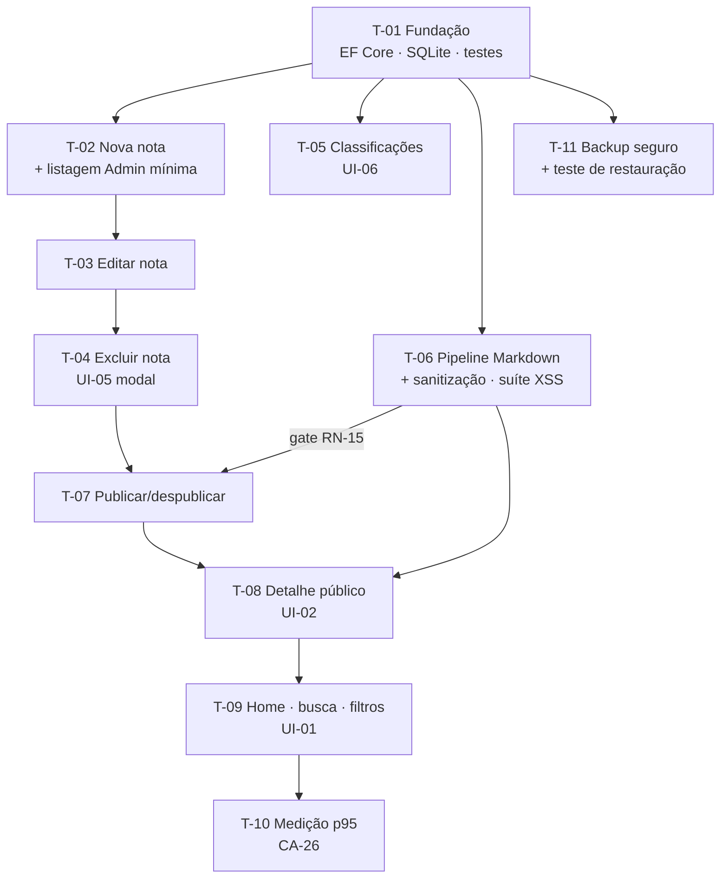

# Plano de Execução: DevNotes — MVP de caderno de notas com busca

**PRD de referência:** `docs/prds/prd-devnotes-mvp.md`
**Arquitetura de referência:** `docs/architecture/proposta-arquitetural.md` (ADR-001..ADR-005)
**SPEC-UI de referência:** `docs/prototype/SPEC-UI-001-devnotes-mvp.md`
**Cliente/Produto:** DevNotes (projeto pessoal)
**Stack:** C# / .NET 10 (`net10.0`), ASP.NET Core Razor Pages, SQLite via EF Core, Bootstrap 5 (vendido em `wwwroot/lib`)
**Autor:** planner-leanwork (aprovado pelo dono do projeto — Gate 28)
**Data:** 2026-10-25
**Status:** Aprovado — 2026-10-25 (Gate 28 fechado pelo dono do projeto; 11 tarefas T-01..T-11, sequência/dependências, matriz RN/CA/UI, gates humanos e gate RN-15 de sanitização preservados; sem acréscimo de funcionalidades ao MVP)

> **Ajuste de ordem (Gate 28, ajuste B):** o pipeline de Markdown/sanitização ficou numerado **antes** da tarefa de publicar/despublicar, para que a dependência de liberação RN-15/ADR-005 aponte **para frente** (regra de gate): publicar/despublicar (T-07) `Depende de:` T-06. Não existe renderização pública de Markdown sem sanitização.

> **Gate automático:** `validate_plan.py` indisponível nesta autorização (Python pendente de decisão — `AGENTS.md`). Validação estrutural feita à mão e anunciada: campos obrigatórios, vocabulário de `Status`, sequência T-01..T-11, dependências sempre para frente (nenhuma tarefa depende de número igual ou maior).

---

## 1. Resumo executivo *(obrigatória)*

Plano incremental de 11 tarefas para o MVP DevNotes, em fatias verticais por `CA-XX`: uma exceção horizontal de fundação (T-01: EF Core/SQLite, schema com migration, projeto de testes xUnit), seguida pela captura completa na área Admin (criar, editar, excluir, classificações), publicação com o pipeline de sanitização como gate de liberação (T-06 antes de T-07), consulta pública (detalhe sanitizado e home com busca), fechando com a medição da meta p95 < 200 ms com 1.000 notas e o procedimento de backup seguro com teste de restauração. A primeira fatia validável no navegador fecha em T-02.

## 2. Estratégia de entrega *(obrigatória)*

**Modelo de entrega:** incremental por fase, operando em `main` na working tree — um lote de alterações por ciclo `/leanwork-execute` + `/leanwork-review`, suíte verde ao final de cada tarefa.

**Critério geral de "pronto":** critérios de aceite testáveis de cada tarefa + testes escritos e verdes. Critérios de done genéricos ficam na Definition of Done do `AGENTS.md` e não se repetem aqui.

**Prontidão específica:**

- **Gate de liberação RN-15/ADR-005:** T-07 (publicar/despublicar) só pode ser `Concluída` depois de T-06 (pipeline de sanitização + suíte XSS/links inseguros) `Concluída`. Antes disso, T-07 teto `Em andamento`.
- **Operação local (RN-16/CA-27/ADR-004):** o app roda exclusivamente no ambiente local restrito. Verificação concreta da configuração de escuta existente desde T-01, com recheque ao fechar cada tarefa que mexe em servidor/rotas. Nenhuma configuração de exposição de rede.
- Sem feature flags: sistema local de usuário único, sem concorrência — a liberação é sequencial.

## 3. Premissas e decisões *(obrigatória se houver)*

Decisões técnicas aprovadas pelo dono (Gate 28). O plano consome, não cria:

- **Decisão:** implementação inteira em `src/DevNotes.Web`, camadas por pastas conforme necessidade — sem class libraries adicionais — *referência: ADR-001 e sua guarda contra over-engineering; aprovação do dono (Gate 28)*
- **Decisão:** projeto de testes único `tests/DevNotes.Tests` com xUnit — testes unitários e de integração — *referência: PRD §13 (dependência aberta fechada); aprovação do dono (Gate 28)*
- **Decisão:** Markdown com **Markdig** e sanitização com **HtmlSanitizer** (namespace `Ganss.Xss`; id no NuGet: `HtmlSanitizer`) — *referência: ADR-005; aprovação do dono (Gate 28)*. Versões contemporâneas à aprovação: `Markdig 1.5.0` e `HtmlSanitizer 9.2.1039`, compatíveis com `net10.0`. Conferir a versão estável vigente no momento da instalação (dentro da T-06) e anotar no artefato da tarefa; nada foi instalado no Gate 28.
- **Decisão:** T-01 é a única fatia horizontal (fundação); T-02..T-09 são fatias verticais por `CA-XX`; T-10 e T-11 são verificação/operação conforme 3.1 e 3.3 da arquitetura

> ⚠️ **Premissa:** o repositório parte do template Razor Pages padrão (`Index`, `Privacy`, `Error`); o descarte do conteúdo de demonstração do template é feito nas fatias que tocam as telas correspondentes (T-09 substitui `Index`), não por tarefa separada.
> ⚠️ **Premissa:** o seed da T-01 cobre apenas os dados de demonstração necessários à primeira fatia (categorias e tecnologias iniciais, **sem notas**) — não é infraestrutura de ambiente; classificações existem sem notas (RN-07).
> ⚠️ **Premissa:** a suíte de XSS/links inseguros (RN-15) é obrigatória na liberação da funcionalidade de publicação e a cada mudança que toque o pipeline de renderização/sanitização; **não** há re-execução por nota publicada.

## 4. Mapa de dependências *(obrigatória se houver mais de 5 tarefas)*

Paralelizável após T-01: T-05, T-06 e T-11 (não dependem de T-02..T-04).

## 5. Fases *(obrigatória)*

### Fase 1 — Fundação *(horizontal — exceção justificada)*

**Objetivo da fase:** estrutura que toda fatia usa — acesso a dados transacional, schema revisionável, suíte de testes e ambiente local restrito verificado.

**Critério de conclusão da fase:** build verde; projeto de testes no `DevNotes.slnx` executando verde; migration aplicável; seed de demonstração carregada; verificação concreta de CA-27 (escuta local) registrada.

---

#### T-01 — Fundação de dados e testes: EF Core + SQLite, migration inicial e projeto xUnit

- **Status:** Pendente
- **Complexidade:** Média
- **Depende de:** nenhuma
- **Implementa:** — (tarefa preparatória)
- **Valida:** — (preparatória; inclui verificação parcial e concreta de CA-27 — escuta local)
- **Decisões base:** ADR-002, ADR-004
- **Portas de mão única:** `migration inicial — schema Nota/Categoria/Tecnologia (N:M) + índices`; `configuração — provider SQLite e caminho do arquivo do banco`

**Descrição:**

Criar `tests/DevNotes.Tests` (xUnit) e incluí-lo no `DevNotes.slnx`. Instalar EF Core + provider SQLite (e `Microsoft.EntityFrameworkCore.Design` para migrations), confirmando compatibilidade de versões com `net10.0` no momento da instalação. Criar o contexto `DevNotesDbContext` com as entidades: `Nota` (título ≤ 200, conteúdo Markdown cru, estado rascunho/publicada, datas de criação e atualização), `Categoria` (nome ≤ 100), `Tecnologia` (nome ≤ 100), N:M nota↔tecnologia e 1:N categoria↔nota, com FKs **sem cascata** (comporta RN-20 no nível do banco). Configurar `Fluent API`: índices (título, estado, FKs), comprimentos máximos e restrições. Gerar a migration inicial. Seed mínima em `Development`: 2 categorias + 3 tecnologias de demonstração — **sem notas** (RN-07). Adicionar o arquivo do banco ao `.gitignore`. Verificação concreta de CA-27 desde aqui: `launchSettings.json`/`applicationUrl` escutam apenas `localhost` — nenhum binding `0.0.0.0` ou de interface de rede (RN-16, ADR-004); registrar no artefato da tarefa.

**Critério de aceite (testável):**
- `dotnet build DevNotes.slnx` verde com `tests/DevNotes.Tests` na solução
- Migration inicial gera schema com FKs sem cascata e índices em `Nota` (título, estado) e nas FKs das relações
- Seed em `Development` carrega 2 categorias + 3 tecnologias, zero notas
- Arquivo do banco ignorado pelo git (confirmado via `git status --ignored`)
- Verificação de escuta local registrada: configuração faz binding somente `localhost` (RN-16, CA-27 parcial)

**Testes a escrever:**
- *Unit:* persistência/recuperação de nota com categoria e tecnologias em SQLite in-memory — nota gravada é nota recuperável com todas as relações (3.3 da arquitetura)
- *Integration:* bootstrap do contexto contra banco migrado (aplica a migration em arquivo temporário e lê o schema)

**Riscos / pontos de atenção:**
- Versão do provider SQLite EF Core para `net10.0` — conferir no `dotnet package search` no momento da instalação
- Caminho do arquivo do banco: manter fora de `wwwroot`; localização final documentada e reutilizada pela T-11
- Catálogo dotnet (`efcore.md`): rastreamento mínimo e ciclo de vida do contexto aplicáveis desde a primeira query

---

### Fase 2 — Captura e gestão (área Admin)

**Objetivo da fase:** capturar, editar, excluir e classificar notas — o fluxo central do dono — sem nenhuma renderização pública de Markdown.

**Critério de conclusão da fase:** CA-01..CA-08 e CA-23..25/CA-28..34 verdes (testes + validação humana do T-02); nenhuma rota pública de conteúdo existe ainda.

---

#### T-02 — Nova nota com validação e listagem Admin mínima (primeira fatia vertical)

- **Status:** Pendente
- **Complexidade:** Média
- **Depende de:** T-01
- **Implementa:** RN-01, RN-02, RN-03, RN-04, RN-05, RN-06, RN-14, RN-18, RN-11, RN-17
- **Valida:** CA-01, CA-02, CA-03, CA-04, CA-05, CA-08
- **Decisões base:** ADR-001 (camadas por pastas), ADR-002 (transação nota+classificações), ADR-004 (área Admin separada), ADR-005 (editor textarea)
- **Telas:** UI-04 (`.default` modo criar, `.validacao`, `.enviando`, `.sucesso`), UI-03 (`.vazio`, `.default` mínima)
- **Portas de mão única:** `rotas — criação da área `/Admin/Notas/*` (base da futura autorização por área, ADR-004)`

**Descrição:**

Serviço de domínio `NoteService` (fora das Razor Pages, testável sem HTTP — meta 3.2): criação valida título (obrigatório, ≤ 200), conteúdo Markdown obrigatório, exatamente uma categoria e ao menos uma tecnologia (RN-01..RN-06), e persiste nota + classificações numa única transação via `SaveChanges` (RN-18, 3.3). Página `Pages/Admin/Notas/Criar` seguindo a SPEC-UI: input de texto com contador `x/200`, textarea monospace sem WYSIWYG nem preview obrigatório (RN-14), select de categoria e lista de checkboxes de tecnologias (acessível por teclado/leitor de tela). Sem checagem de duplicidade de título (RN-03). Listagem Admin mínima (`Pages/Admin/Notas`): título, selos de classificação, data de atualização (RN-11/RN-17) e estado do item — as ações chegam em T-04/T-07. Validação server-side; re-render com `ModelState` preserva os dados digitados (UI-04 `.validacao`).

**Critério de aceite (testável):**
- CA-01..CA-05 e CA-08 reproduzíveis por teste (cenários do PRD)
- Nota salva como rascunho por padrão; nota nunca fica gravada sem categoria/tecnologias (RN-18)
- Submissão inválida não grava nada e re-render preserva os dados digitados (CA-02/CA-03/CA-04)
- Contador `x/200` visível no campo título
- Nenhum caminho de renderização de Markdown nesta tarefa — conteúdo permanece cru no banco

**Testes a escrever:**
- *Unit:* `NoteService` cria nota válida com relações; rejeita título vazio/201 caracteres, conteúdo em branco, nota sem categoria e sem tecnologia — erro sem gravar (CA-02/CA-03/CA-04); aceita título duplicado (CA-05)
- *Integration:* WebApplicationFactory — POST cria nota e ela aparece na listagem; POST inválido re-renderiza com erros inline e dados preservados; campo de conteúdo é `textarea`, sem editor rico no HTML (CA-08)

**Riscos / pontos de atenção:**
- Lista de checkboxes precisa ser multisseleção nativa acessível — a funcionalidade básica não depende de JS (SPEC-UI §9)
- Antiforgery em todos os POSTs desde a primeira página de escrita

---

#### T-03 — Editar nota (mesma tela, modo edição)

- **Status:** Pendente
- **Complexidade:** Baixa
- **Depende de:** T-02
- **Implementa:** RN-01, RN-02, RN-03, RN-04, RN-05, RN-06, RN-18 (revalidação no modo edição), RN-17
- **Valida:** CA-02, CA-03, CA-04 (modo edição), CA-05
- **Decisões base:** ADR-002 (atualização transacional), ADR-005
- **Telas:** UI-04 (`.default` modo edição, `.validacao`, `.sucesso`)
- **Portas de mão única:** nenhuma

**Descrição:**

Extensão da página de T-02 para editar nota existente (`/Admin/Notas/Editar/{id}`, campos pré-preenchidos), reutilizando o mesmo `NoteService` com atualização transacional de nota + tecnologias. Salvar revalida tudo (RN-01..RN-06); título duplicado segue permitido (RN-03). Estado (rascunho/publicada) **não** é alterado pela edição — sem toggle no formulário (RN-13); conteúdo e classificações são substituídos, data de criação preservada e data de atualização avança (RN-17).

**Critério de aceite (testável):**
- Campos pré-preenchidos no modo edição; submissão válida persiste atualização de conteúdo e classificações na mesma transação
- Submissões inválidas no modo edição não sobrescrevem nada no banco (CA-02/CA-03/CA-04 em edição)
- Edição não altera o estado publicada/rascunho (RN-13)
- Data de atualização recalculada no salvar; data de criação inalterada

**Testes a escrever:**
- *Unit:* `NoteService` atualiza nota e relações transacionalmente; estado não muda na edição
- *Integration:* GET do modo edição pré-preenche; POST edita e redireciona para a listagem com flash "Nota salva"; POST inválido re-renderiza com dados preservados

**Riscos / pontos de atenção:**
- Multisseleção: sincronizar checkboxes com as relações persistidas (tecnologias removidas no formulário precisam sair do banco) — teste dedicado ao risco de perda silenciosa (RN-18)

---

#### T-04 — Excluir nota definitivamente com confirmação (modal UI-05)

- **Status:** Pendente
- **Complexidade:** Baixa
- **Depende de:** T-03
- **Implementa:** RN-08
- **Valida:** CA-06, CA-07
- **Decisões base:** ADR-004 (exclusão é operação Admin)
- **Telas:** UI-05 (`.confirmacao`, `.cancelada`, `.sucesso`), UI-03 (`.sucesso`)
- **Portas de mão única:** nenhuma

**Descrição:**

Ação "Excluir" na listagem abre o modal Bootstrap de confirmação (UI-05), reutilizando o componente `ModalConfirmacao` da SPEC-UI: título da nota-alvo, aviso "a exclusão é permanente — não há lixeira", botão destrutivo destacado `danger` + "Cancelar". Exclusão é hard delete (RN-08), sem lixeira/arquivamento nesta fase. Cancelamento (Esc, botão ou clique fora) fecha o modal sem requisição — nada muda (CA-07). POST confirmado remove a nota e suas relações e exibe flash "Nota excluída" (CA-06); foco preso ao diálogo conforme padrão de acessibilidade da SPEC-UI.

**Critério de aceite (testável):**
- CA-06: confirmação remove a nota permanentemente (some da listagem e não volta em busca que venha a existir)
- CA-07: cancelar não dispara requisição — nota intacta
- Modal acessível: abre com foco preso, Esc/cancelar fecham sem ação; nenhuma exclusão acontece com um único clique direto

**Testes a escrever:**
- *Unit:* serviço de exclusão remove nota e relações sem deixar órfãos
- *Integration:* POST de exclusão apaga a nota; POST sem token antiforgery é rejeitado
- *Não aplicável* — estados do modal (`.confirmacao`/`.cancelada`) são client-side e ficam para a validação humana no navegador

**Riscos / pontos de atenção:**
- Ação destrutiva só por POST com token antiforgery — nunca GET de exclusão

---

#### T-05 — Classificações: categorias e tecnologias (UI-06)

- **Status:** Pendente
- **Complexidade:** Média
- **Depende de:** T-01
- **Implementa:** RN-07, RN-20, RN-21, RN-22, RN-23
- **Valida:** CA-23, CA-24, CA-25, CA-28, CA-29, CA-30, CA-31, CA-32, CA-33, CA-34
- **Decisões base:** ADR-001, ADR-002 (FKs sem cascata)
- **Telas:** UI-06 (`.default`, `.sucesso`, `.validacao`, `.exclusao`, `.bloqueado`, `.vazio` por aba)
- **Portas de mão única:** nenhuma

**Descrição:**

CRUD completo das duas taxonomias independentes em `/Admin/Classificacoes`: abas "Categorias"/"Tecnologias" (Bootstrap tabs como melhoramento progressivo; navegação funciona sem JS), listas planas sem hierarquia (CA-25), contagem de notas por item (informativa, feedback de uso). Serviço de domínio próprio valida nome (obrigatório, ≤ 100 — RN-22) e duplicidade **dentro do tipo**, ignorando caixa e espaços nas pontas (RN-23); nome igual em tipos distintos é aceito (CA-34 — espaços de nomes independentes). Exclusão: item **em uso** por nota(s) é bloqueado com mensagem clara ("Não é possível excluir: em uso por N nota(s)"), sem exclusão em cascata — nenhuma associação é removida (RN-20, CA-28/CA-29); item **sem vínculos** pede confirmação em modal igual ao da UI-05; cancelar não altera nada (RN-21, CA-30/CA-31).

**Critério de aceite (testável):**
- CA-23/CA-24: cadastro nas duas abas disponível no formulário de nota e persiste sem nenhuma nota associada (RN-07)
- CA-28/CA-29: exclusão em uso bloqueada com mensagem que conta as notas; vínculos permanecem (sem cascata)
- CA-30/CA-31: exclusão sem vínculos exige confirmação em modal; cancelar não altera os dados
- CA-32: nome vazio ou com 101 caracteres recusado com mensagem de validação
- CA-33/CA-34: `"ia agêntica "` vs `"IA Agêntica"` é duplicado no mesmo tipo; "Agente" aceite nos dois tipos distintos

**Testes a escrever:**
- *Unit:* comparação de duplicidade (caixa + espaços nas pontas) isolada por tipo (CA-33/CA-34); bloqueio em uso com contagem (CA-28/CA-29); validação de nome (CA-32)
- *Integration:* cadastro/edição/exclusão nas duas abas; tentativa de exclusão em uso responde com mensagem de bloqueio e remove nada (CA-28/CA-29)

**Riscos / pontos de atenção:**
- `Trim()` antes de comparar **e** de salvar — não persistir nome com espaços nas pontas
- Contagem de vínculos: query direta sobre as relações, sem carregar notas inteiras (catálogo `efcore.md` — projeção)

---

### Fase 3 — Publicação e consulta pública

**Objetivo da fase:** o pipeline de sanitização como gate de liberação (RN-15), o estado publicada/rascunho reversível (RN-13) e a consulta pública de leitura (detalhe sanitizado + home com busca).

**Critério de conclusão da fase:** CA-09..CA-22 verdes; nenhuma renderização de conteúdo de nota fora do serviço sanitizado; a consulta exibe somente publicadas.

---

#### T-06 — Pipeline Markdown → HTML sanitizado + suíte de segurança (gate RN-15)

- **Status:** Pendente
- **Complexidade:** Alta
- **Depende de:** T-01
- **Implementa:** RN-15
- **Valida:** CA-12, CA-13, CA-14 (nível de suíte backend; a verificação end-to-end em tela fica para T-08)
- **Decisões base:** ADR-005
- **Portas de mão única:** `configuração — política de allow-list de sanitização (blocos, atributos e esquemas permitidos — segurança por configuração)`

**Descrição:**

Instalar `Markdig` (versão de referência `1.5.0`) e `HtmlSanitizer` (namespace `Ganss.Xss`; versão de referência `9.2.1039`) — conferindo a estável vigente e anotando no artefato. Registrar `IMarkdownRenderService` no DI: Markdown cru → HTML (Markdig) → HTML sanitizado (HtmlSanitizer). Política por **allow-list** conservadora: sem `<script>`, sem `iframe`/`object`/`embed`, sem atributos de manipulador de evento (`on*`), links apenas com esquemas seguros — `javascript:` e `data:` ficam inertes (CA-13). Suíte automatizada **obrigatória** de segurança (CA-12/CA-13/CA-14 como testes de serviço): injeção de `<script>`, manipuladores embutidos (`onerror`, `onload`), vetores em `img`/`video`, links `javascript:`/`data:` — nenhum código executável sobrevive na saída; e fidelidade: blocos de código, listas e links legítimos sobrevivem íntegros (CA-14). Esta suíte é **pré-requisito para liberar a funcionalidade de publicação** (T-07) e re-executa na íntegra sempre que qualquer mudança tocar o pipeline (RN-15).

**Critério de aceite (testável):**
- Suíte XSS/links verde: todos os vetores testados não sobrevivem à saída (CA-12, CA-13)
- Conteúdo técnico legítimo renderiza fielmente no teste (CA-14)
- Nenhum call site direto de Markdig fora do serviço (inspeção no review)
- Versões de Markdig/HtmlSanitizer anotadas no artefato da tarefa

**Testes a escrever:**
- *Unit:* um teste por classe de vetor (script, `on*`, `javascript:`, `data:`, vetores de imagem) + conjunto de fidelidade (código/lista/negrito/links legítimos)

**Riscos / pontos de atenção:**
- O default do `HtmlSanitizer` é conservador — qualquer relaxamento de allow-list deve ser o mínimo e revisado (config de segurança é porta de mão única)
- Catálogo dotnet (`seguranca-owasp.md`): citar o código do item de XSS/sanitização no review

---

#### T-07 — Publicar/despublicar na área Admin

- **Status:** Pendente
- **Complexidade:** Baixa
- **Depende de:** T-04, T-06 (**gate RN-15 — ver Prontidão específica**)
- **Implementa:** RN-13, RN-10, RN-16
- **Valida:** CA-09, CA-10, CA-11 (lado Admin), CA-27
- **Decisões base:** ADR-004
- **Telas:** UI-03 (`.sucesso` de publicar/despublicar), `SeloEstado` (2 valores)
- **Portas de mão única:** nenhuma

**Descrição:**

Ações "Publicar"/"Despublicar" por item na listagem Admin (UI-03): POST com antiforgery, alterna rascunho ⇄ publicada, página recarrega com flash correspondente e `SeloEstado` atualizado (publicada = success; rascunho = secondary). Operação reversível, sem alterar o conteúdo (RN-13, CA-10). Nota publicada passa a ser visível à consulta futura (T-08/T-09); rascunho nunca aparece na consulta (RN-09/RN-10). Recheque de CA-27 ao fechar: rotas Admin separadas, sem autenticação, **sem configuração de exposição de rede** — escuta segue local (RN-16); declaração da ADR-004 preservada (a separação não protege acesso).

**Critério de aceite (testável):**
- CA-09/CA-10: estado alternado refletido no banco; conteúdo idêntico antes e depois (RN-13)
- CA-11 (parceiro de T-08): rascunho inacessível por rota pública
- CA-27: operações funcionam sem qualquer autenticação no ambiente local; configuração sem binding de rede (inspeção `launchSettings`/`appsettings`)
- Gate: T-06 `Concluída` antes desta tarefa passar de `Em andamento`

**Testes a escrever:**
- *Unit:* serviço de publicação alterna estado sem tocar conteúdo nem datas de conteúdo
- *Integration:* POST publicar/despublicar altera estado e exibe flash correspondente; POST sem token antiforgery rejeitado

**Riscos / pontos de atenção:**
- Publicar não alterna por edição — separação estado ↔ ação da SPEC-UI (sem botão publicar no formulário, UI-04)

---

#### T-08 — Detalhe público da nota publicada (UI-02)

- **Status:** Pendente
- **Complexidade:** Média
- **Depende de:** T-06, T-07
- **Implementa:** RN-02, RN-09, RN-10, RN-15, RN-17
- **Valida:** CA-12, CA-13, CA-14 (end-to-end), CA-22 (datas no detalhe), CA-11
- **Decisões base:** ADR-004 (rota pública fora de `/Admin`), ADR-005 (sanitização por render)
- **Telas:** UI-02 (`.default`, `.naoEncontrado`)
- **Portas de mão única:** `contrato público — rota GET /Notas/{id}`

**Descrição:**

Rota `/Notas/{id}`: somente nota publicada responde 200 (RN-09); id inválido, inexistente **ou rascunho** → 404 "Nota não encontrada", distinta de erro técnico (UI-02 `.naoEncontrado`; RN-10). Conteúdo renderizado exclusivamente via `IMarkdownRenderService` (T-06) — HTML sanitizado existe só na saída, a fonte segue crua no banco (ADR-005). Cabeçalho com título, selos de classificação (links para filtros de UI-01) e datas de criação/atualização (RN-17); blocos de código com fundo de código e fonte monospace (tokens da SPEC-UI); contêiner de leitura em coluna única.

**Critério de aceite (testável):**
- CA-12/CA-13/CA-14 end-to-end: nota publicada com conteúdo malicioso renderiza sem `<script>` e com links inertes; conteúdo técnico fiel (código/listas)
- CA-11: rascunho → 404; CA-22: datas de criação e atualização exibidas no detalhe
- Nenhum HTML cru de nota na resposta — sanitização antes de qualquer saída (inspeção no review)

**Testes a escrever:**
- *Integration:* nota publicada retorna 200 com HTML sanitizado (vetores da T-06 verificados sobre HTTP); rascunho/inexistente retornam 404; payload do detalhe carrega datas e selos com hrefs de filtro corretos

**Riscos / pontos de atenção:**
- Única rota de leitura até T-09 — manter coluna única e largura de leitura da SPEC-UI

---

#### T-09 — Home: listagem de publicadas, busca única e navegação por classificação (UI-01)

- **Status:** Pendente
- **Complexidade:** Média
- **Depende de:** T-08
- **Implementa:** RN-09, RN-11, RN-12, RN-17, RN-04, RN-05
- **Valida:** CA-15, CA-16, CA-17, CA-18, CA-19, CA-20, CA-21, CA-22
- **Decisões base:** ADR-003 (busca por consulta indexada, sem FTS), ADR-004 (só publicadas), ADR-005 (`ResumoMarkdownSeguro`)
- **Telas:** UI-01 (`.default`, `.resultado`, `.vazio`, `.vazioFiltro` — 2 variantes), `CardNota`, `SeloClassificacao`, `ListaVazia`
- **Portas de mão única:** `contrato público — query strings de busca/filtro `/?q=`, `/?categoria=`, `/?tecnologia=``

**Descrição:**

Substituir a `Index` do template: bloco de busca em destaque (formulário GET, funcional sem JS) + listagem de notas publicadas ordenada por atualização mais recente (RN-11), cada item como `CardNote`→`CardNota` (título → detalhe, resumo de 1–2 linhas como **texto simples derivado do Markdown cru** — sem tags e sem interpretação de markup, decisão aprovada da SPEC-UI), selos de categoria/tecnologia clicáveis (filtro por query string) e data de atualização (RN-17). Busca única (RN-12) cobrindo título (prefixo), conteúdo (termo), categoria e tecnologia (CA-15..CA-17) — sem operadores; resultados do serviço de busca (EF Core, `AsNoTracking`, sem N+1) com estados de vazio tratados ("N notas encontradas para 'termo'", "Nenhuma nota encontrada" — CA-18, não erro). Coluna lateral de categorias/tecnologias (retrátil no mobile) com item ativo destacado; estados `.vazio` (primeiro uso, com ação "Criar na área Admin") e `.vazioFiltro`.

**Critério de aceite (testável):**
- CA-15..CA-17: busca encontra por título, conteúdo, categoria e tecnologia, sem operadores
- CA-18: busca sem resultados exibe mensagem de vazio, não erro técnico
- CA-19/CA-20/CA-21: só publicadas; ordenação por atualização desc; filtros por categoria/tecnologia corretos
- CA-22: data de atualização visível na listagem
- Resumo nunca contém tag HTML nem markup interpretado — derivação só texto (inspeção no review)

**Testes a escrever:**
- *Unit:* serviço de busca — matching por prefixo de título, termo de conteúdo, categoria e tecnologia; ordenação
- *Integration:* CA-15..CA-21 via HTTP; contagem de resultados; estados vazio; rascunho invisível em qualquer estado da página

**Riscos / pontos de atenção:**
- `LIKE '%termo%'` no conteúdo é varredura — esperado no volume da v1 (ADR-003); a medição da T-10 decide por dados
- As mesmas consultas da UI serão medidas na T-10 — não criar caminho de busca paralelo

---

### Fase 4 — Desempenho e operação

**Objetivo da fase:** comprovar a meta de busca por medição (não presumir) e fechar a durabilidade com backup seguro validado por teste de restauração.

**Critério de conclusão da fase:** medição p95 documentada (ou gatilho FTS5 reconhecido pelo dono); procedimento de backup com teste de restauração registrado e validado.

---

#### T-10 — Medição da meta p95 < 200 ms com 1.000 notas (CA-26)

- **Status:** Pendente
- **Complexidade:** Alta
- **Depende de:** T-09
- **Implementa:** RN-19
- **Valida:** CA-26
- **Decisões base:** ADR-003 (busca v1 orientada por medição)
- **Portas de mão única:** nenhuma

**Descrição:**

Banco de referência com ~1.000 notas de **tamanho realista** (títulos e conteúdos tecnicamente plausíveis — não placeholders de 1 linha), gerado por fixture no projeto de testes, separado do seed de demonstração. Medir em série, na máquina de uso real e sem escrita concorrente: busca por título (prefixo), busca por termo do conteúdo, navegação por categoria — registrando o p95 de cada consulta. Critérios de medição exatamente os da seção 3.1 da arquitetura (banco de referência, ambiente, consultas medidas, métrica p95, registro). As consultas medidas são as mesmas que a UI executa (T-09) — medir outro caminho invalida o CA-26. Resultado (contagem de execuções, p95 por consulta, data) documentado no artefato da tarefa. Se a meta não fechar, registrar explicitamente como gatilho da dívida FTS5 (arq. §9) — o aceite é do dono, não do executor (ponto de validação humana).

**Critério de aceite (testável):**
- Medição executa as 3 consultas conforme 3.1 e registra p95 por consulta, com contagem de execuções e data
- Resultado documentado no artefato da tarefa
- CA-26: cada consulta com p95 < 200 ms **ou** divergência registrada explicitamente como gatilho FTS5 aguardando decisão do dono

**Testes a escrever:**
- *Teste de medição dedicado:* fixture de 1.000 notas + cronometragem das consultas (fora do fluxo de regressão rápida; executado manualmente para a medição formal)

**Riscos / pontos de atenção:**
- Ruído de ambiente (debugger, antivírus, indexação) — medir em build de release, sem conexão de depuração
- Se a medição estourar, **não** otimizar por conta própria: reportar e aguardar decisão (ADR-003 é orientada por medição)

---

#### T-11 — Procedimento de backup seguro do SQLite + teste de restauração

- **Status:** Pendente
- **Complexidade:** Baixa
- **Depende de:** T-01
- **Implementa:** — (operação de durabilidade, 3.3 da arquitetura; suporta RN-18)
- **Valida:** — (sem CA funcional; evidência operacional documentada)
- **Decisões base:** ADR-002
- **Portas de mão única:** nenhuma

**Descrição:**

Documento de operação com o procedimento oficial de backup: API de backup do SQLite ou `VACUUM INTO` — **nunca cópia casual do arquivo em uso** (cópia direta com escrita em andamento ou WAL ativo pode nascer corrompida, ADR-002). Incluir o primeiro **teste de restauração** executado e registrado (cópia restaurada abre no app com os dados íntegros) e a periodicidade acordada — backup só vale com restauração validada. Não é feature: é operação da seção 3.3, fora do escopo funcional do PRD.

**Critério de aceite (testável):**
- Procedimento documentado (passo a passo reproduzível, incluindo comando/rotina e local do arquivo)
- Teste de restauração executado uma vez e registrado com data e resultado
- Periodicidade do backup e do re-teste de restauração acordada e registrada

**Testes a escrever:**
- *Não aplicável* — tarefa operacional/documental

**Riscos / pontos de atenção:**
- Executar o backup apenas com o app sem escrita em andamento (ou usar o mecanismo oficial, que dispensa isso)
- Local do arquivo do banco definido na T-01 — o procedimento deve apontar o caminho real

---

## 6. Testes transversais *(opcional)*

- [ ] **Smoke end-to-end do MVP:** capturar nota (T-02) → editar (T-03) → excluir com confirmação (T-04) → publicar/despublicar (T-07) → ler no detalhe público (T-08) → buscar/filtrar (T-09), percorrendo todos os estados principais das UI-01..UI-06 no navegador
- [ ] **Re-execução da suíte de segurança (RN-15):** ao fechar o MVP e a cada mudança futura que toque o pipeline de renderização/sanitização — evidência registrada a cada execução
- [ ] **Regressão de persistência:** transacionalidade nota + classificações (RN-18) e FKs sem cascata (RN-20) revalidadas após qualquer mudança no modelo

## 7. Rollback e contingência *(obrigatória se houver migration ou breaking change)*

- Risco de rollback consciente nesta fase é baixo: sistema local, sem produção, dados em arquivo SQLite único
- Migrations do EF Core: cada migration é reversível individualmente (`dotnet ef migrations list` / `update <anterior>`); nenhuma migration desta lista é destrutiva
- Arquivo do banco é dado do dono, fora do git (T-01) — recriar o schema não restaura conteúdo; o rollback de dados é o backup da T-11 (mecanismo oficial + restauração testada)
- Em caso de regressão de segurança no pipeline de sanitização (T-06): a mitigação é travar a liberação de publicação/consulta (T-07/T-08) até a suíte retornar ao verde — nunca atenuar testes

## 8. Pontos de validação humana *(obrigatória)*

- [ ] Após **T-01** — conferir migration/índices, seed e a verificação de escuta local (CA-27) antes de seguir
- [ ] Após **T-02** — **primeira vertical no navegador:** criar nota, ver validação e listagem (CA-01..CA-08 demonstrados)
- [ ] Após **T-04** — modal de exclusão: confirmar e cancelar no navegador (CA-06/CA-07 visuais)
- [ ] Após **T-05** — classificação em uso bloqueada e exclusão sem vínculos com modal (CA-28..CA-31 visuais)
- [ ] Após **T-06** — liberação do gate RN-15: suíte XSS/links verde antes de publicar qualquer conteúdo
- [ ] Após **T-08** — nota maliciosa aberta no navegador: nenhum script executado, links inertes (CA-12/CA-13 em tela)
- [ ] Após **T-10** — **aprovar o resultado da medição p95** (meta fecha ou assumption/gatilho FTS5 é reconhecido pelo dono)
- [ ] Após **T-11** — validar o procedimento de backup e o teste de restauração registrado
- [ ] Fechamento do MVP — percorrer o smoke end-to-end da seção 6 no navegador

## 9. Questões em aberto *(opcional)*

- [ ] Conferir a versão estável vigente de `Markdig` e `HtmlSanitizer` no momento da instalação (referências atuais: 1.5.0 / 9.2.1039) — *responsável: executor da T-06* — *bloqueia: T-06*
- [ ] Definir a localização definitiva do arquivo do banco (fora de `wwwroot`; ex.: `App_Data/`) e apontá-la no procedimento da T-11 — *responsável: executor da T-01* — *bloqueia: T-11*
- [ ] Nenhum ADR avulso necessário — as decisões de engenharia foram aprovadas pelo dono no Gate 28 e registradas na seção 3 deste plano

---

## Apêndice — Matriz de rastreabilidade (RN · CA · UI → T)

### Regras de negócio (RN-01..RN-23)

| RN | Tarefa(s) |
|---|---|
| RN-01, RN-02, RN-04, RN-05, RN-06, RN-18 | T-02, T-03 |
| RN-03 | T-02, T-03 |
| RN-07, RN-20, RN-21, RN-22, RN-23 | T-05 |
| RN-08 | T-04 |
| RN-09, RN-10 | T-07, T-08, T-09 |
| RN-11, RN-17 | T-02 (base), T-08, T-09 |
| RN-12 | T-09 |
| RN-13 | T-07 |
| RN-14 | T-02 |
| RN-15 | T-06 (suíte + pipeline), T-08, T-09 (uso do pipeline) |
| RN-16, CA-27 | T-01 (verificação inicial), T-07 (recheque) — transversal |
| RN-19 | T-10 |

### Cenários Gherkin (CA-01..CA-34)

| CA | Tarefa(s) |
|---|---|
| CA-01..CA-05, CA-08 | T-02 |
| CA-02..CA-04, CA-05 (modo edição) | T-03 |
| CA-06, CA-07 | T-04 |
| CA-23, CA-24, CA-25, CA-28..CA-34 | T-05 |
| CA-12, CA-13, CA-14 (suíte backend) | T-06 |
| CA-09, CA-10, CA-11 (lado Admin), CA-27 | T-07 |
| CA-12, CA-13, CA-14 (end-to-end), CA-22 (detalhe), CA-11 | T-08 |
| CA-15..CA-22 (listagem/busca/filtros) | T-09 |
| CA-26 | T-10 |

### Telas (UI-01..UI-06)

| UI | Tarefa(s) | Estados |
|---|---|---|
| UI-01 | T-09 | `.default`, `.resultado`, `.vazio`, `.vazioFiltro` (2 variantes) |
| UI-02 | T-08 | `.default`, `.naoEncontrado` |
| UI-03 | T-02 (mínima com `.vazio`/`.default`), T-04 (`.sucesso` de exclusão), T-07 (`.sucesso` publicar/despublicar + `SeloEstado`) | estados construídos em fatias |
| UI-04 | T-02 (criar), T-03 (editar) | `.default`, `.validacao`, `.enviando`, `.sucesso` |
| UI-05 | T-04 | `.confirmacao`, `.cancelada`, `.sucesso` |
| UI-06 | T-05 | `.default`, `.sucesso`, `.validacao`, `.exclusao`, `.bloqueado`, `.vazio` |

Cobertura fechada: **RN-01..RN-23**, **CA-01..CA-34** e **UI-01..UI-06** mapeados às tarefas T-01..T-11, com CA-26 e CA-27 aceitos como cenários sem tela (decisão do Gate 27) e materializados em T-10 e T-01/T-07 respectivamente.
