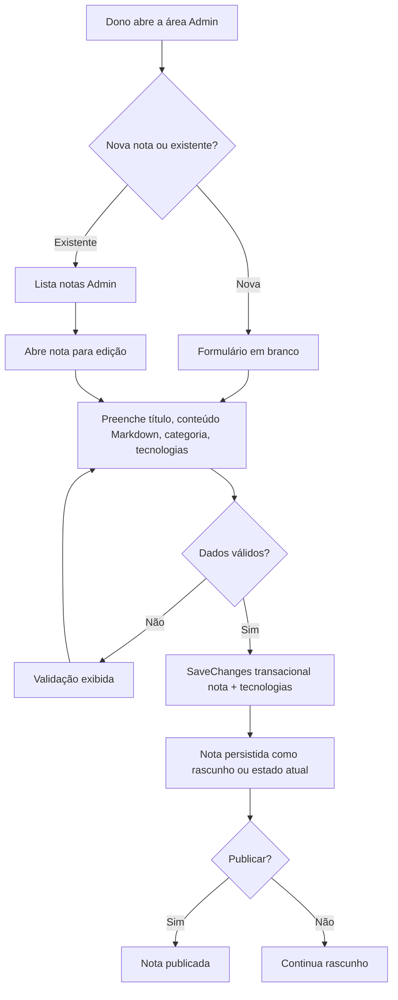
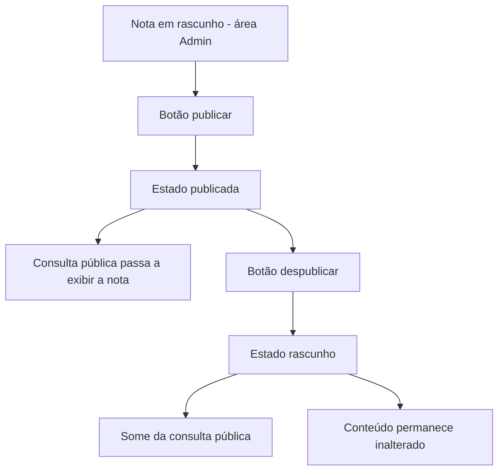
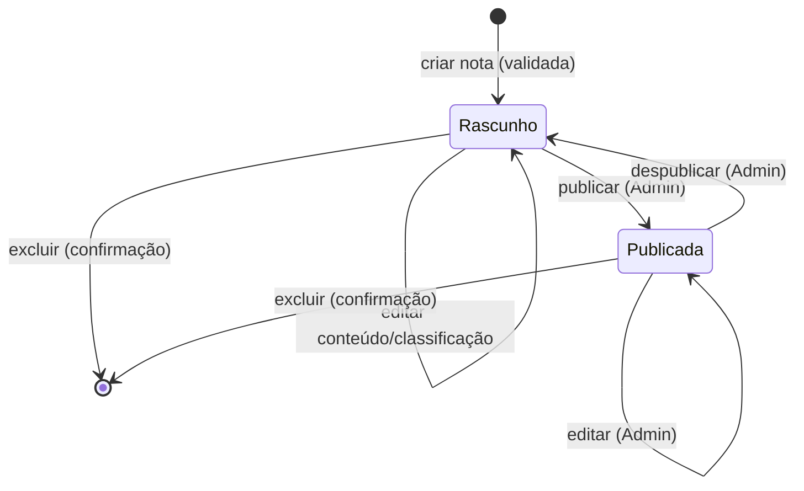

# PRD: DevNotes — MVP de caderno de notas com busca

**Cliente/Produto:** DevNotes (projeto pessoal)
**Autor:** Dono do projeto (entrevista de requisitos, skill `prd-leanwork`)
**Data:** 2026-10-25
**Status:** Aprovado — 2026-10-25 (Gate 26 fechado pelo dono do projeto; cinco correções de revisão aplicadas e verificadas; complemento mínimo de classificações aprovado em 2026-10-25, RN-20..RN-23 e CA-28..CA-34)

---

## 1. Visão geral *(obrigatória)*

Este PRD especifica o MVP do **DevNotes**: um caderno pessoal de referência técnica em C#/.NET, desenvolvimento de software e IA agêntica. O dono do acervo cria notas em Markdown dentro do próprio app, classifica cada nota com uma categoria (ex.: "Desenvolvimento Web") e uma ou mais tecnologias (ex.: "ASP.NET Core"), e encontra qualquer nota em segundos por busca única ou navegação por categoria/tecnologia. Notas ficam em rascunho até serem explicitamente publicadas; a consulta pública só exibe publicadas; toda a escrita acontece numa área Admin separada da leitura. O app roda localmente, sem autenticação nesta fase, e é operado por uma única pessoa.

## 2. Problema e contexto *(obrigatória)*

**Problema:** o conhecimento técnico acumulado está espalhado entre anotações avulsas e é lento de recuperar na hora em que importa — ao codar, estudar ou responder a uma dúvida. A dor declarada é **achar rápido**.

**Contexto atual:** não existe sistema. As notas vivem em arquivos avulsos e na memória. A arquitetura já está aprovada e versionada (`docs/architecture/proposta-arquitetural.md`, ADR-001 a ADR-005) — monolito Razor Pages + SQLite/EF Core, operação local de usuário único.

**Impacto de não fazer:** o caderno não substitui as anotações avulsas; conhecimento valioso continua disperso e se perde. O acervo é o ativo do sistema — perdê-lo invalida o propósito (3.3 da arquitetura).

## 3. Objetivo *(obrigatória)*

**Permitir que o dono registre conhecimento técnico em notas Markdown organizadas por categoria e tecnologia, e encontre qualquer nota em segundos, com publicação controlada e consulta pública isolada da administração.**

### Métricas de sucesso *(opcional)*

- Busca por texto e navegação por categoria/tecnologia retornam em **p95 < 200 ms** com 1.000 notas locais, medidas segundo os critérios documentados na seção 3.1 da arquitetura (meta a verificar por medição, não resultado já comprovado — ADR-003)
- Zero escrita silenciosamente perdida: salvar nota é transacional, nota gravada é nota recuperável (3.3, ADR-002)

## 4. Escopo *(obrigatória)*

### 4.1. Dentro do escopo

- Cadastro, edição e exclusão definitiva de notas (área Admin)
- Classificação da nota: uma categoria principal + uma ou mais tecnologias
- Gerenciamento de categorias e tecnologias na área Admin (podem existir sem notas)
- Conteúdo em Markdown cru, renderizado no servidor com sanitização (ADR-005)
- Editor Markdown simples (textarea), sem WYSIWYG nem preview obrigatório
- Busca única por título, conteúdo, categoria e tecnologia, sem operadores avançados (ADR-003)
- Listagens e navegação por categoria/tecnologia, ordenadas por atualização mais recente
- Publicação e despublicação na área Admin, operação reversível (rascunho ⇄ publicada)
- Consulta pública exibindo somente notas publicadas, com metadados de data
- Área Admin separada da consulta no desenho de rotas/páginas (ADR-004)

### 4.2. Fora do escopo

- Autenticação/autorização — decisão declarada na arquitetura (2.3); a separação Admin/consulta é estrutural, não proteção de acesso (ADR-004)
- Exposição do app à rede de qualquer tipo — operações Admin só em ambiente local restrito (ADR-004, decisão L8)
- Visitantes reais e perfis de múltiplos usuários — estado futuro dirigindo decisões, não entregue nesta fase
- Hierarquias de categoria/tecnologia — decisão L1: sem hierarquia nesta fase
- Lixeira, arquivamento ou exclusão suave — decisão L3: exclusão definitiva com confirmação
- Editor enriquecido (WYSIWYG/live preview client-side) — dívida consciente registrada (arq. 9, ADR-005)
- Busca full-text FTS5, relevância, subpalavra — evolução orientada por medição (ADR-003)
- Operadores avançados de busca (AND/OR, filtros combinados) — decisão L4
- Integrações externas (GitHub, Obsidian, IA), sincronização multi-dispositivo, colaboração (2.3)
- Rotina de backup — é operação documentada (3.3, ADR-002), não feature funcional

## 5. Personas e usuários impactados *(obrigatória se houver UI)*

| Persona | Papel | Como interage com a feature |
|---------|-------|----------------------------|
| Dono do acervo | Único usuário real na v1 | Escreve, edita, exclui, publica e busca suas próprias notas, dentro da máquina local |
| Leitor de consulta | Papel estrutural (hoje o próprio dono; futuro: visitantes) | Navega e busca somente notas publicadas; não tem escrita |

Existem dois "papéis de tela", não dois usuários: a área Admin e a rota de consulta são separações de interface/desenho (ADR-004), não de conta.

## 6. Fluxos *(obrigatória se houver interação)*

### 6.1. Fluxo principal — capturar e editar nota (área Admin)



O dono abre a área Admin, cria ou abre uma nota, preenche título, conteúdo Markdown, categoria e tecnologias. Ao salvar, o sistema valida (RN-01..RN-06) e persiste a nota e suas tecnologias numa única transação (3.3, ADR-002). A nota salva fica em rascunho até a publicação explícita (6.2).

### 6.2. Fluxo secundário — publicar e consultar



Publicar/despublicar é operação reversível exclusiva da área Admin (RN-13); a consulta pública sempre reflete só o estado "publicada" (RN-09), na renderização sanitizada (RN-15).

### 6.3. Desvios e erros

- **Título vazio ou além de 200 caracteres:** formulário recusa e exibe validação (RN-01, CA-02)
- **Conteúdo vazio:** formulário recusa (RN-02, CA-03)
- **Sem categoria ou sem tecnologia:** formulário recusa (RN-06, CA-04)
- **Exclusão sem confirmação:** nada acontece — a confirmação é pré-requisito (RN-08, CA-07)
- **Busca sem resultados:** página exibe estado vazio claro, não erro técnico (RN-12, CA-18)
- **Render de nota com conteúdo malicioso (XSS/link inseguro):** sanitização bloqueia; suíte automatizada obrigatória antes da liberação da funcionalidade e de cada liberação relevante subsequente (RN-15, CA-12..CA-13)
- **Concorrência de escrita SQLite visível ao usuário:** fora da v1 (limitação declarada, arq. 9) — sem cenário nesta fase

## 7. Regras de negócio *(obrigatória)*

- **RN-01:** nota exige título obrigatório, com máximo de 200 caracteres — sem outros limites de negócio inventados (decisão L2)
- **RN-02:** nota exige conteúdo em Markdown, obrigatório; o Markdown cru é a fonte única de verdade, armazenada no banco *(ADR-002, ADR-005)* (decisão L2)
- **RN-03:** títulos duplicados são permitidos; não há unicidade de título (decisão L2)
- **RN-04:** cada nota possui exatamente uma categoria principal — relação 1:N, categoria é obrigatória (decisão L1)
- **RN-05:** cada nota possui uma ou mais tecnologias — relação N:M; uma tecnologia pode pertencer a várias notas e uma categoria pode conter várias notas (decisão L1)
- **RN-06:** criar/editar nota exige categoria e pelo menos uma tecnologia — nenhum dos dois campos pode ficar em branco (decisões L1, L2)
- **RN-07:** categorias e tecnologias são cadastradas/gerenciadas na área Admin, podem existir sem nenhuma nota, e não têm hierarquia nesta fase (decisão L1)
- **RN-08:** exclusão de nota é definitiva (hard delete), mediante confirmação explícita na UI; não existe lixeira nem arquivamento na v1 (decisão L3)
- **RN-09:** a consulta pública exibe somente notas no estado "publicada" *(ADR-004)* (decisão L4)
- **RN-10:** rascunhos ficam disponíveis apenas na área Admin, nunca na consulta pública (decisão L4, ADR-004)
- **RN-11:** listagens compartilham a ordenação padrão: atualização mais recente primeiro (decisão L4)
- **RN-12:** busca é caixa única cobrindo título, conteúdo, categoria e tecnologia, sem operadores avançados na v1 *(ADR-003)* (decisão L4)
- **RN-13:** publicar e despublicar são operações exclusivas da área Admin, reversíveis; despublicar retorna a nota a rascunho sem alterar o conteúdo *(ADR-004)* (decisão L5)
- **RN-14:** editor é Markdown simples, sem WYSIWYG e sem preview obrigatório na v1 *(ADR-005)* (decisão L6)
- **RN-15:** a renderização de Markdown é feita no servidor por pipeline com sanitização, obrigatória em **toda renderização**; a suíte automatizada de testes contra XSS e links inseguros (incluindo `javascript:` e `data:`) é obrigatória **antes da liberação da funcionalidade de publicação e antes de cada liberação relevante** — qualquer mudança que afete o pipeline de renderização/sanitização reexige a suíte; não é execução única na vida do projeto, e **não** é execução a cada publicação de nota *(ADR-005)* (decisão L8)
- **RN-16:** sem autenticação na v1, as operações administrativas só podem ser utilizadas em ambiente local restrito; nenhuma exposição de operações Admin à rede — a área Admin separada não equivale a proteção de acesso *(ADR-004)* (decisão L8)
- **RN-17:** listagens exibem a data de atualização; a página de detalhe exibe datas de criação e atualização (decisão L7)
- **RN-18:** salvar nota persiste nota, categoria e tecnologias transacionalmente — nota nunca fica gravada sem suas classificações ou vice-versa nas operações normais do fluxo (3.3) *(ADR-002)*
- **RN-19:** o desempenho da busca e navegação é verificado contra a meta p95 < 200 ms com 1.000 notas, pelos critérios de medição da seção 3.1 da arquitetura — alvo a comprovar, não resultado assumido (3.1) *(ADR-003)*
- **RN-20:** categoria ou tecnologia associada a uma ou mais notas **não pode ser excluída** — a tentativa é bloqueada com mensagem clara explicando o motivo; **não existe exclusão em cascata** *(decisão do dono, complemento de classificações, 2026-10-25)*
- **RN-21:** classificação sem nenhum vínculo pode ser excluída, mediante confirmação explícita em modal; o cancelamento não altera os dados *(decisão do dono, complemento de classificações, 2026-10-25)*
- **RN-22:** nome de categoria ou tecnologia é obrigatório, com máximo de 100 caracteres *(decisão do dono, complemento de classificações, 2026-10-25)*
- **RN-23:** não é permitido nome duplicado **dentro do mesmo tipo de classificação** — a comparação ignora diferenças de maiúsculas/minúsculas e espaços nas pontas; categoria e tecnologia têm espaços de nomes independentes (nomes iguais nos dois tipos são permitidos) *(decisão do dono, complemento de classificações, 2026-10-25)*

## 8. Critérios de aceite *(obrigatória)*

```gherkin
Funcionalidade: Capturar e gerenciar notas (área Admin)

  Cenário [CA-01]: Criar nota com dados válidos
    Dado que estou na área Admin
    E que existem a categoria "Desenvolvimento Web" e as tecnologias "C#" e "ASP.NET Core" (RN-07)
    Quando submeto uma nota com título "Caching em ASP.NET Core", conteúdo Markdown válido, categoria "Desenvolvimento Web" e tecnologias "C#" e "ASP.NET Core"
    Então a nota é persistida como rascunho (RN-13)
    E a nota fica associada a exatamente uma categoria e duas tecnologias (RN-04, RN-05)

  Esquema do Cenário [CA-02]: Recusar título vazio ou com 201 caracteres
    Dado que estou no formulário de nota (RN-01)
    Quando submeto com título "<título>"
    Então a submissão é recusada com mensagem de validação
    E nenhuma nota é gravada

    Exemplos:
      | título                        |
      | (vazio)                       |
      | (cadeia de 201 caracteres)    |

  Cenário [CA-03]: Recusar conteúdo vazio
    Dado que estou no formulário de nota (RN-02)
    Quando submeto com título válido e conteúdo em branco
    Então a submissão é recusada com mensagem de validação
    E nenhuma nota é gravada

  Esquema do Cenário [CA-04]: Recusar nota sem categoria ou sem tecnologia
    Dado que estou no formulário de nota (RN-06)
    Quando submeto uma nota válida sem "<classificação>"
    Então a submissão é recusada com mensagem apontando <classificação> obrigatória
    E nenhuma nota é gravada

    Exemplos:
      | classificação |
      | categoria     |
      | tecnologia    |

  Cenário [CA-05]: Permitir títulos duplicados
    Dado que existe a nota "Caching em ASP.NET Core" (RN-03)
    Quando submeto outra nota com o mesmo título e conteúdo diferente
    Então ambas as notas coexistem no acervo

  Cenário [CA-06]: Excluir nota definitivamente mediante confirmação
    Dado que existe a nota "Rascunho obsoleto" na área Admin (RN-08)
    Quando aciono excluir na nota
    Então o sistema exige confirmação explícita
    Quando confirmo a exclusão
    Então a nota é removida permanentemente do acervo
    E não existe caminho de recuperação (sem lixeira/arquivamento)

  Cenário [CA-07]: Exclusão sem confirmação não remove
    Dado que existe a nota "Contratos" na área Admin (RN-08)
    Quando recuso a confirmação de exclusão
    Então a nota permanece intacta

  Cenário [CA-08]: Editor de nota é Markdown simples
    Dado que abro o formulário de nova nota na área Admin (RN-14) (ADR-005)
    Quando o formulário é renderizado
    Então o campo de conteúdo é um editor de texto simples
    E não existe editor WYSIWYG nem preview obrigatório na v1
```

```gherkin
Funcionalidade: Publicação e consulta de notas

  Cenário [CA-09]: Publicar nota tornando-a visível na consulta
    Dado que existe a nota "Autofac scope" em rascunho na área Admin (RN-13)
    Quando aciono publicar
    Então a nota fica no estado "publicada"
    E ela aparece na consulta pública (RN-09)

  Cenário [CA-10]: Despublicar volta a rascunho sem alterar conteúdo
    Dado que existe a nota "Autofac scope" publicada (RN-13)
    Quando aciono despublicar na área Admin
    Então a nota volta a rascunho
    E seu conteúdo permanece igual ao anterior
    E ela deixa de aparecer na consulta pública (RN-09)

  Cenário [CA-11]: Consulta pública não exibe rascunhos
    Dado que existe a nota publicada "ADO.NET para SQL Server" e o rascunho "Polia pensada" (RN-09, RN-10)
    Quando abro a consulta pública
    Então vejo "ADO.NET para SQL Server"
    E não vejo "Polia pensada"
    E o rascunho só está acessível na área Admin

  Cenário [CA-12]: Renderização sanitizada bloqueia script injetado
    Dado que existe uma nota publicada cujo conteúdo Markdown contém "<script>alert(1)</script>" (RN-15) (ADR-005)
    Quando a consulta pública renderiza a nota
    Então o HTML exibido não contém "<script>"
    E nenhum código JavaScript é executado no navegador

  Cenário [CA-13]: Renderização sanitizada bloqueia links inseguros
    Dado que existe uma nota publicada com link "javascript:alert(1)" e outro "data:text/html,..." (RN-15) (ADR-005)
    Quando a consulta pública renderiza os links
    Então nenhum deles fica clicável com esquema perigoso
    E a sessão/caminho do usuário não executa o esquema

  Cenário [CA-14]: Conteúdo técnico renderiza fielmente
    Dado que existe uma nota publicada com bloco de código e listas (RN-02) (ADR-005)
    Quando a consulta pública renderiza a nota
    Então o bloco de código é exibido como código
    E a lista é exibida como lista
```

```gherkin
Funcionalidade: Busca, navegação e listagens

  Cenário [CA-15]: Busca encontra notas por título
    Dado que existe a nota publicada "Caching em ASP.NET Core" (RN-12) (ADR-003)
    Quando busco "caching"
    Então a nota aparece nos resultados

  Cenário [CA-16]: Busca encontra por termo no conteúdo
    Dado que existe a nota publicada "Caching em ASP.NET Core" com "IMemoryCache" no conteúdo (RN-12)
    Quando busco "imemory"
    Então a nota aparece nos resultados
    E a busca cobre o conteúdo, sem operadores avançados

  Esquema do Cenário [CA-17]: Busca encontra por categoria e por tecnologia
    Dado que existe a nota publicada "Consultas no SQL Server", da categoria "Banco de Dados" e com a tecnologia "ADO.NET" (RN-12)
    Quando busco "<termo>"
    Então a nota aparece nos resultados
    E a busca cobre categoria e tecnologia, sem operadores avançados

    Exemplos:
      | termo           |
      | Banco de Dados  |
      | ADO.NET         |

  Cenário [CA-18]: Busca sem resultados exibe estado vazio claro
    Dado que nenhuma nota publicada contém o termo (RN-12)
    Quando busco "zzz-inexistente"
    Então a página exibe uma mensagem de "nenhum resultado", não um erro

  Cenário [CA-19]: Listagem exibe somente notas publicadas
    Dado que existem notas publicadas e rascunhos (RN-09, RN-10)
    Quando abro a listagem da consulta pública
    Então só aparecem notas publicadas

  Cenário [CA-20]: Listagens ordenam por atualização mais recente
    Dado que existem duas notas publicadas "A" e "B" (RN-11)
    E que "A" foi atualizada depois de "B"
    Quando abro qualquer listagem
    Então "A" aparece antes de "B"

  Cenário [CA-21]: Navegação por categoria e tecnologia
    Dado que a nota "Caching em ASP.NET Core" é da categoria "Desenvolvimento Web" e tecnologia "ASP.NET Core" (RN-04, RN-05)
    Quando abro a categoria "Desenvolvimento Web"
    Então a nota aparece na listagem
    Quando abro a tecnologia "ASP.NET Core"
    Então a nota também aparece

  Cenário [CA-22]: Listagens exibem data de atualização e detalhe exibe criação e atualização (RN-17)
    Dado que existe a nota publicada "Caching em ASP.NET Core"
    Quando abro a listagem
    Então vejo a data de atualização da nota
    Quando abro o detalhe
    Então vejo as datas de criação e de atualização
```

```gherkin
Funcionalidade: Classificação (categorias e tecnologias) — área Admin

  Cenário [CA-23]: Cadastrar categoria na área Admin
    Dado que estou na gestão de categorias da área Admin (RN-07)
    Quando cadastro a categoria "Banco de Dados"
    Então ela fica disponível no formulário de nota
    E pode existir sem nenhuma nota associada

  Cenário [CA-24]: Cadastrar tecnologia e reutilizar em notas
    Dado que estou na gestão de tecnologias da área Admin (RN-07)
    Quando cadastro a tecnologia "ADO.NET"
    Então ela fica disponível no formulário de nota
    E pode ser associada a várias notas (relação N:M, RN-05)

  Cenário [CA-25]: Sem hierarquia nas classificações
    Dado que "Desenvolvimento Desktop" e "IA Agêntica" existem (RN-07)
    Quando visualizo qualquer listagem de categorias ou tecnologias
    Então não existe categoria-pai nem subcategoria — só listas planas
```

```gherkin
Funcionalidade: Desempenho (meta de busca)

  Cenário [CA-26]: Busca e navegação fecham a meta p95 < 200 ms
    Dado um banco com ~1.000 notas de tamanho realista (3.1 da arquitetura) (RN-19) (ADR-003)
    E na máquina de uso real, sem escrita concorrente
    Quando meço por série as consultas: busca por título, busca por termo do conteúdo, navegação por categoria
    Então cada consulta registra p95 < 200 ms
    E o resultado (execuções, data) fica documentado no artefato da tarefa
```

```gherkin
Funcionalidade: Operação local restrita (sem autenticação na v1)

  Cenário [CA-27]: Área Admin funciona em ambiente local e sem falso escudo
    Dado que o app roda em ambiente local restrito, máquina do dono (RN-16) (ADR-004)
    Quando realizo qualquer operação da área Admin
    Então ela funciona sem solicitar qualquer autenticação
    E fica claro no desenho que a separação de área não protege acesso
    E nenhuma operação Admin está configurada para exposição de rede
```

```gherkin
Funcionalidade: Classificações — exclusão e validação de nomes (área Admin)

  Cenário [CA-28]: Bloquear exclusão de categoria em uso
    Dado que existe a categoria "Banco de Dados" associada a uma ou mais notas (RN-20)
    Quando tento excluir essa categoria
    Então a exclusão é bloqueada
    E exibida mensagem clara explicando que a classificação está em uso
    E nenhuma nota tem sua associação removida (sem exclusão em cascata)

  Cenário [CA-29]: Bloquear exclusão de tecnologia em uso
    Dado que existe a tecnologia "ADO.NET" associada a uma ou mais notas (RN-20)
    Quando tento excluir essa tecnologia
    Então a exclusão é bloqueada
    E exibida mensagem clara explicando que a classificação está em uso
    E a tecnologia permanece associada às notas

  Cenário [CA-30]: Excluir classificação sem vínculos mediante confirmação
    Dado que existe a tecnologia "XAML" sem nenhuma nota associada (RN-21)
    Quando aciono excluir na tecnologia
    Então o sistema pede confirmação em modal
    Quando confirmo
    Então a tecnologia é excluída definitivamente

  Cenário [CA-31]: Cancelamento de exclusão de classificação não altera dados
    Dado que existe a categoria "IA Agêntica" sem nenhuma nota associada (RN-21)
    Quando abro o modal de exclusão e cancelo
    Então a categoria permanece cadastrada intacta

  Cenário [CA-32]: Recusar nome de classificação vazio ou além de 100 caracteres
    Dado que estou no cadastro/edição de uma classificação (RN-22)
    Quando submeto com nome vazio ou com cadeia de 101 caracteres
    Então a submissão é recusada com mensagem de validação
    E nenhuma classificação é gravada

  Cenário [CA-33]: Recusar nome duplicado no mesmo tipo de classificação
    Dado que existe a categoria "IA Agêntica" (RN-23)
    Quando cadastro no tipo "Categoria" o nome "ia agêntica " (ignora maiúsculas/minúsculas e espaços na ponta)
    Então a submissão é recusada com mensagem de nome duplicado
    E nenhuma classificação é gravada

  Cenário [CA-34]: Permitir mesmo nome em tipos diferentes
    Dado que existe a categoria "Agente" (RN-23)
    Quando cadastro no tipo "Tecnologia" o nome "Agente"
    Então o cadastro é aceito
    E os espaços de nomes das duas classificações ficam independentes
```

> Complemento de classificações: RN-20..RN-23 e CA-28..CA-34 aprovados pelo dono em 2026-10-25 (decisões de exclusão bloqueada, validação de nomes e confirmação em modal), refletidos na SPEC-UI em `docs/prototype/SPEC-UI-001-devnotes-mvp.md` — a rastreabilidade desses cenários com a UI-06 está na seção 7 da SPEC-UI.

## 9. Permissionamento *(obrigatória se houver controle de acesso)*

Na v1 não existe controle de acesso por conta (sem auth — ADR-004). A tabela descreve o papel funcional; a única salvaguarda é a restrição de ambiente:

| Ação | Papel autorizado | Observação |
|------|-----------------|------------|
| Criar/editar/excluir nota, publicar/despublicar | Dono do acervo | Área Admin — só ambiente local restrito (RN-16, ADR-004) |
| Cadastrar/editar categoria e tecnologia, excluir | Dono do acervo | Idem (RN-07, RN-16) |
| Consultar/buscar/ler notas | Leitor de consulta (hoje: o próprio dono) | Só notas publicadas (RN-09) |
| Exposição de qualquer operação Admin à rede | Ninguém | Regra dura da decisão L8 / ADR-004 |

## 10. Integrações e dados *(obrigatória se aplicável)*

### 10.1. Sistemas envolvidos

- **n/a** — nenhum sistema externo na fase (arq. §6: um processo, nenhum serviço adicional)

### 10.2. Dados consumidos

- Nenhum dado de fonte externa — todas as entidades nascem no próprio app

### 10.3. Dados produzidos / persistidos

- **Notas**: título, conteúdo Markdown cru, estado (rascunho/publicada), datas de criação e atualização — SQLite via EF Core (ADR-002)
- **Categorias**: nome próprio, relação 1:N com notas (RN-04)
- **Tecnologias**: nome próprio, relação N:M com notas (RN-05)
- Renderização de HTML sanitizado é saída da renderização, jamais armazenada como fonte (ADR-005)

### 10.4. Eventos

- **n/a** — sem filas/mediator/eventos na arquitetura da fase

## 11. Diagrama de estados *(opcional — ciclo de vida da nota)*



Publicar/despublicar é reversível e nunca altera conteúdo (RN-13); exclusão é definitiva mediante confirmação (RN-08).

## 12. Restrições e premissas *(opcional)*

- **Restrição:** stack fixa — C#/.NET 10, ASP.NET Core Razor Pages, SQLite/EF Core, nullable + implicit usings (AGENTS.md, ADR-001/002); catálogo de boas práticas dotnet obrigatório
- **Restrição:** meta de busca p95 < 200 ms @ 1.000 notas — alvo a comprovar por medição com critérios da seção 3.1 (RN-19)
- **Restrição:** sem autenticação nesta fase; qualquer uso além do ambiente local restrito é proibido na v1 (RN-16, ADR-004)
- **Premissa:** uso restrito a uma única pessoa; concorrência de escrita não é requisito (arq. 9 — dívida consciente)
- **Premissa:** backup é operação documentada fora do escopo funcional (3.3, ADR-002)

## 13. Riscos e dependências *(obrigatória)*

| Tipo | Descrição | Mitigação / Plano |
|------|-----------|-------------------|
| Risco | Busca por termo no meio do conteúdo (`LIKE '%termo%'`) não usa índices convencionais (ADR-003) | Meta medida por CA-26 com critérios 3.1; FTS5 é evolução orientada pelo resultado (arq. 9) |
| Risco | Sanitização ser mal configurada e deixar passar XSS | CAs de primeira classe (CA-12/CA-13, RN-15, ADR-005): suíte obrigatória na liberação da funcionalidade e antes de cada liberação relevante que toque a renderização; sanitização obrigatória em toda renderização |
| Risco | Exclusão definitiva sem confirmação apagar nota valiosa | Confirmação explícita é requisito (CA-06/RN-08); sem lixeira por decisão do dono |
| Risco | Operações Admin acessíveis fora do ambiente local | Regra dura: só ambiente local restrito (RN-16, ADR-004); auth é pré-requisito de qualquer exposição |
| Dependência | Arquitetura aprovada e ADR-001..005 versionados | Fechada — fonte canônica `docs/architecture/proposta-arquitetural.md` |
| Dependência | Projeto de testes ainda não existe (AGENTS.md marca TODO) | Será criado no plano de execução; os CAs de publicação exigem testes automatizados (RN-15) |

## 14. Rastreabilidade com a arquitetura *(referência cruzada)*

| Decisão/atributo | Seção arq. | Regras/cenários derivados |
|---|---|---|
| Monolito Razor Pages, sem abstração sem necessidade (ADR-001) | 5 | RN-12 simples, sem motor dedicado |
| SQLite + EF Core transacional, backup seguro (ADR-002) | 3.3, 5, 6.1 | RN-02, RN-18; CA-01 |
| Busca v1 sem FTS; LIKE curinga limitado (ADR-003) | 5 | RN-12, RN-19; CA-15..CA-18, CA-26 |
| Admin separado ≠ proteção; local restrito (ADR-004) | 5, 10 | RN-09, RN-10, RN-13, RN-16; CA-09..CA-11, CA-27 |
| Markdown cru + sanitização; testes XSS/links (ADR-005) | 5, 7.1, 10 | RN-02, RN-14, RN-15; CA-08, CA-12..CA-14 |
| Meta p95 < 200 ms com critérios (3.1) | 3.1 | RN-19; CA-26 |
| Complemento de classificações (decisão do dono, 2026-10-25 — não deriva de ADR) | Entrevista Gate 27 | RN-20..RN-23; CA-28..CA-34 (rastreabilidade com UI-06 na SPEC-UI-001) |
| Durabilidade transacional (3.3) | 3.3 | RN-18; CA-01 |

## 15. Referências *(opcional)*

- Arquitetura canônica: `docs/architecture/proposta-arquitetural.md` (ADR-001..ADR-005, seções 2, 3, 9, 10)
- Guia do projeto: `AGENTS.md` (stack, catálogo dotnet, restrições de processo)
- Entrevista de requisitos (2026-10-25): decisões L1–L8 aprovadas pelo dono — fonte deste PRD
