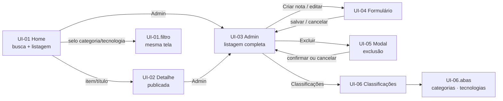

# SPEC-UI-001: DevNotes — MVP de caderno de notas com busca

> **PRD de referência:** `docs/prds/prd-devnotes-mvp.md`
> **Arquitetura de referência:** `docs/architecture/proposta-arquitetural.md`
> **Modo:** Geração (sem protótipo prévio no repositório)
> **Artefato visual:** pendente — HTML estático navegável será gerado em etapa posterior, se aprovado
> **Fidelidade:** Wireframe estrutural funcional (estética Bootstrap com personalização leve)
> **Autor:** Dono do projeto (skill `prototype-leanwork`, com inventário e decisões visuais aprovados)
> **Data:** 2026-10-25
> **Status:** Aprovado — 2026-10-25 (Gate 27 fechado pelo dono do projeto; complemento de classificações RN-20..RN-23 / CA-28..CA-34 refletido em UI-06; CA-26 e CA-27 aceitos como critérios técnicos sem tela)

---

## 1. Contexto de interface

**Arquétipo:** Ferramenta interna / app de operação pessoal (metade consulta pública de leitura, metade área Admin de escrita)

**Dispositivo alvo:** Desktop-first com responsividade (decisão aprovada no Gate 27 — inventário)

**Stack de frontend:** ASP.NET Core Razor Pages (.NET 10), SSR, Bootstrap 5 vendido em `src/DevNotes.Web/wwwroot/lib/` com `_Layout.cshtml` existente — **herdado, não reinventado** (ADR-001)

**Origem das informações deste documento:**

| Fonte | O que veio dela |
|---|---|
| Repositório | Stack, `_Layout` com Bootstrap 5 vendido, estrutura Razor Pages |
| PRD aprovado | Todas as RN-01..RN-19 e CA-01..CA-27; personas; estados derivados dos cenários de erro |
| Arquitetura aprovada | ADR-001..005 (monolito SSR, sanitização por render, Admin separado ≠ proteção, busca sem FTS) |
| Entrevista (aprovação do inventário, 2026-10-25) | Fidelidade wireframe; cores sóbrias; busca central na Home; formato das listagens; modal de exclusão; link Admin visível; multisseleção de tecnologias acessível; CRUD completo em UI-06; resumo seguro de Markdown |

---

## 2. Tokens de design

Fidelidade wireframe: paleta enxuta, sólida, contraste alto — tokenização mínima sobre o Bootstrap padrão.

| Token | Valor | Origem |
|---|---|---|
| Primária | `#3B4A63` (azul-ardósia sóbrio) | Informado na entrevista ("cores sóbrias") |
| Texto base | `#212529` (Bootstrap body) | Bootstrap padrão |
| Superfície | `#FFFFFF` / fundo de página `#F8F9FA` | Bootstrap padrão |
| Erro/validação | `#B02A37` (Bootstrap danger) | Bootstrap padrão |
| Sucesso (flash) | `#157347` (Bootstrap success) | Bootstrap padrão |
| Fundo de código | `#F1F3F5` | Informado na entrevista (conteúdo técnico) |
| Fonte base | System stack do Bootstrap | Herdada |
| Fonte de código | Stack monospace (textarea e `pre`) | Informado na entrevista |
| Escala de espaçamento | Grelha e utilitários Bootstrap | Herdada |

> Nenhum design system próprio existe no repositório — os tokens acima são a personalização "leve" aprovada. O craft fino (sombra, raio de canto, tipografia) é de wireframe: utilitários Bootstrap default.

---

## 3. Inventário de telas

| ID | Tela | Rota | Persona | Implementa (RN) | Valida (CA) |
|---|---|---|---|---|---|
| UI-01 | Home — busca em destaque + listagem publicadas + navegação por categoria/tecnologia | `/` (filtros por query string) | Leitor de consulta | RN-09, 11, 12, 17 | CA-15, 16, 17, 18, 19, 20, 21, 22 |
| UI-02 | Detalhe da nota publicada (render sanitizada) | `/Notas/{id}` | Leitor de consulta | RN-02, 15, 17 | CA-12, 13, 14, 22 |
| UI-03 | Admin — listagem completa de notas com estado | `/Admin/Notas` | Dono do acervo | RN-08, 10, 11, 13, 17 | CA-09, 10, 11 (momento da ação) |
| UI-04 | Formulário de nota (nova/editar) | `/Admin/Notas/Criar` e `/Admin/Notas/Editar/{id}` (mesma tela, dois modos) | Dono do acervo | RN-01, 02, 03, 04, 05, 06, 14, 18 | CA-01, 02, 03, 04, 05, 08 |
| UI-05 | Modal de confirmação de exclusão de nota | modal sobre UI-03 | Dono do acervo | RN-08 | CA-06, 07 |
| UI-06 | Classificações — categorias e tecnologias (cadastro, edição, exclusão) | `/Admin/Classificacoes` | Dono do acervo | RN-07, 20, 21, 22, 23 | CA-23, 24, 25, 28, 29, 30, 31, 32, 33, 34 |

Ações de publicar/despublicar (RN-13, CA-09/CA-10) são botões na UI-03, não tela própria. Modal UI-05 não tem rota.

---

## 4. Telas em detalhe

### UI-01 — Home: busca em destaque + listagem publicada

**Propósito:** achar qualquer nota publicada em segundos — busca central e navegação por categoria/tecnologia.

**Rota:** `/` (busca: `/?q=...`; filtro por categoria: `/?categoria=...`; por tecnologia: `/?tecnologia=...`)

**Persona:** Leitor de consulta (hoje o próprio dono — só notas publicadas, RN-09)

**Regras que se manifestam:**

| Regra | Como aparece na tela |
|---|---|
| RN-09 | Só notas publicadas na listagem e nos resultados de busca — rascunho nunca chega a esta tela |
| RN-11 | Listagem e resultados ordenados por atualização mais recente primeiro |
| RN-12 | Uma caixa de busca única cobrindo título, conteúdo, categoria e tecnologia — sem operadores visíveis |
| RN-17 | Cada item exibe data de atualização |
| RN-04/RN-05 | Selos de categoria e tecnologias em cada item; links de navegação por categoria e tecnologia |

**Estados:**

| Estado | ID | Quando ocorre | O que o usuário vê | Origem |
|---|---|---|---|---|
| Padrão | `UI-01.default` | Há notas publicadas | Bloco de busca em destaque + listagem com resumo e selos | Entrevista (busca central) |
| Resultado de busca | `UI-01.resultado` | Busca `q` retorna resultados | Contagem ("N notas encontradas para 'termo'") + resultados; busca permanece preenchida | Derivado do PRD |
| Vazio — sem acervo | `UI-01.vazio` | Nenhuma nota publicada (primeiro uso) | Mensagem educativa + ação sugerida "Criar na área Admin" (link) | Derivado do PRD |
| Vazio por filtro/busca | `UI-01.vazioFiltro` | Busca ou filtro não retorna nada | "Nenhuma nota encontrada" (não erro, CA-18) + ação "limpar busca/filtro" | Derivado de CA-18 |
| Filtro sem publicadas | `UI-01.vazioFiltro` | Categoria/tecnologia existe, mas sem nota publicada | Mensagem específica: "Nenhuma nota publicada nesta classificação" | Derivado do PRD |

`.carregando` e `.erro`: **n/a — renderização SSR** (página completa já chega pronta; erro de banco exibe página de erro padrão do ASP.NET Core, fora do escopo dos estados de UI).

**Elementos principais:**

- **Bloco de busca em destaque** no topo (herói wireframe): input com botão "Buscar"; submete via GET para o `/?q=` estado independente de JS
- **Busca permanece preenchida** após a submissão (estado resultado)
- **Listagem de notas** — `CardNota`: título (link para UI-02), resumo curto (1–2 linhas), selos de categoria e tecnologias, data de atualização
- **Navegação por classificação** — coluna lateral (desktop) / retrátil (mobile): listas planas de categorias e tecnologias disponíveis para filtro; item ativo destacado quando filtrado
- link "Admin" na navbar: sempre visível (decisão aprovada; RN-16 — sem auth nesta fase)

**Resumo de Markdown — segurança:**

- O resumo é derivado do Markdown cru **como texto simples**: sem tags HTML, sem renderização parcial de Markdown, sem execução de nada (decisão aprovada). A renderização de Markdown só acontece sanitizada em UI-02 — a listagem nunca interpreta markup, nem uma linha de HTML.

**Navegação:**

- Item da listagem / título → `UI-02`
- Selos de categoria/tecnologia → `/?categoria=` / `/?tecnologia=` (mesma tela filtrada)
- "Admin" → `UI-03`

---

### UI-02 — Detalhe da nota publicada

**Propósito:** ler a nota técnica renderizada de forma segura e fiel.

**Rota:** `/Notas/{id}` — só notas com estado "publicada" respondem com 200 (RN-09)

**Persona:** Leitor de consulta

**Regras que se manifestam:**

| Regra | Como aparece na tela |
|---|---|
| RN-02 | Markdown cru do banco renderizado no servidor — a fonte nunca é o HTML armazenado |
| RN-15 | Saída renderizada pelo pipeline com sanitizações obrigatórias: script removido (CA-12), `javascript:`/`data:` inertes (CA-13) |
| RN-17 | Datas de criação e atualização exibidas |
| RN-09 | Nota rascunho/despublicada não acessível nesta rota |

**Estados:**

| Estado | ID | Quando ocorre | O que o usuário vê | Origem |
|---|---|---|---|---|
| Padrão | `UI-02.default` | Nota publicada existente | Conteúdo renderizado: código como código, listas como listas (CA-14); cabeçalho com título, categoria, tecnologias, datas | Derivado dos CA |
| Rascunho inacessível | `UI-02.naoEncontrado` | Id inválido, nota inexistente ou nota em rascunho | Página "Nota não encontrada" (404), distinta de erro técnico | Derivado de RN-09/RN-10 |

**Elementos principais:**

- Cabeçalho: título, selos (categoria, tecnologias, links para filtro em UI-01), datas criação/atualização
- Corpo: HTML sanitizado ao servir; blocos de código com fundo de código e fonte monospace
- Contêiner de largura de leitura confortável (desktop), coluna única

**Navegação:** voltar → UI-01; selos → filtros de UI-01.

---

### UI-03 — Admin: listagem completa de notas

**Propósito:** dar visibilidade a todas as notas do acervo (incluindo os rascunhos) e concentrar as ações (publicar, despublicar, editar, excluir).

**Rota:** `/Admin/Notas`

**Persona:** Dono do acervo — **ambiente local restrito (RN-16); a área Admin não protege acesso (ADR-004)**

**Regras que se manifestam:**

| Regra | Como aparece na tela |
|---|---|
| RN-10 | Rascunhos aparecem **só aqui** — listados na sequência das publicadas (mesma ordenação, RN-11), com selo de estado |
| RN-13 | Botões "Publicar" (em rascunho) e "Despublicar" (em publicada) por item; operação sem tela própria; página recarrega após a ação |
| RN-11 | Ordenação por atualização mais recente |
| RN-17 | Data de atualização por item |
| RN-08 | Ação "Excluir" — abre modal UI-05 |

**Estados:**

| Estado | ID | Quando ocorre | O que o usuário vê | Origem |
|---|---|---|---|---|
| Padrão | `UI-03.default` | Há notas (rascunhos e/ou publicadas) | Lista com selo de estado por item (publicada: success; rascunho: secondary) + ações | Derivado do PRD |
| Sucesso de ação | `UI-03.sucesso` | Publicar/despublicar/excluir concluído | Flash de sucesso ("Nota publicada", "Nota despublicada", "Nota excluída") | Derivado do PRD |
| Vazio | `UI-03.vazio` | Acervo inexistente | "Nenhuma nota ainda" + ação "Criar primeira nota" → UI-04 | Derivado do PRD |

`.carregando`/`.erro`/`.conflito`: n/a — SSR e uso single-user; concorrência de escrita não é requisito (arq. 9, dívida declarada), sem estado especificado nesta fase.

**Elementos principais:**

- Cabeçalho da área Admin + menu secundário: "Notas" e "Classificações"
- Filtro pelo estado (três opções: todas / rascunhos / publicadas) — via query string
- Por item: título (→ UI-04 modo edição), selos de classificação, data, botões de ação
- "Criar nota" → UI-04 modo nova

---

### UI-04 — Formulário de nota (nova/editar)

**Propósito:** capturar/editar nota com título, conteúdo Markdown (editor simples), categoria e tecnologias.

**Rotas:** `/Admin/Notas/Criar` (modo nova) e `/Admin/Notas/Editar/{id}` (modo edição, campos pré-preenchidos) — **uma especificação de tela, dois modos**

**Persona:** Dono do acervo (local restrito)

**Regras que se manifestam:**

| Regra | Como aparece na tela |
|---|---|
| RN-01 | Campo título obrigatório, `maxlength=200`; validação por campo com mensagem localizada |
| RN-02 | Campo conteúdo Markdown obrigatório (textarea) |
| RN-03 | Sem checagem de duplicidade de título — nota com título repetido salva normalmente |
| RN-04 | Select de categoria único — exatamente uma categoria por nota (RN-04) |
| RN-05 | **Multisseleção de tecnologias** — lista de checkboxes (interação acessível nativamente: teclado, rótulos, leitor de tela), no mínimo uma habilitada |
| RN-06 | Categoria e tecnologia exigidas em qualquer modo |
| RN-14 | Editor é textarea com fonte monospace, altura generosa, sem WYSIWYG e sem preview |
| RN-18 | SaveChanges transacional — nota + tecnologias; ao salvar, tudo fica consistente |

**Estados:**

| Estado | ID | Quando ocorre | O que o usuário vê | Origem |
|---|---|---|---|---|
| Default — nova | `UI-04.default` | Criar nova nota | Campos em branco | Derivado do PRD |
| Default — edição | `UI-04.default` | Editar nota existente | Campos pré-preenchidos com o estado atual | Derivado do PRD |
| Validação | `UI-04.validacao` | CA-02/CA-03/CA-04 rejeitam | Erros inline um por campo (título, conteúdo, categoria, tecnologias) + resumo; **dados digitados preservados** | Derivado dos CAs |
| Enviando | `UI-04.enviando` | Submissão em processamento | Botão desabilitado — previne envio duplo | Catálogo (formulário) |
| Sucesso | `UI-04.sucesso` | Salvamento válido | Redireciona para UI-03 com flash "Nota salva" | Derivado do PRD |

- `.erroEnvio` (falha do servidor): estrutura disponível — re-render com ModelState preserva os dados digitados; o ponto crítico "perder dados" fica endereçado pela validação server-side com replay
- `.conflito`: n/a — usuário único na v1 (sem edição concorrente especificada)

**Elementos principais:**

- Título: input texto com contador visível `x/200` (afordance do máximo de RN-01)
- Conteúdo: textarea full width, monospace, ~20 linhas de altura, sem toolbar
- Categoria: select com as categorias cadastradas (UI-06); se não houver nenhuma, helper com link para UI-06
- Tecnologias: lista de checkboxes (multisseleção acessível); helper se nenhuma existir
- Botões: "Salvar" (submit), "Voltar para listagem"
- Sem botão de publicar no formulário — fluxo de publicação acontece na UI-03 (separação estado ↔ ação)

**Navegação:** salvar → UI-03 (flash); cancelar/voltar → UI-03.

---

### UI-05 — Modal de confirmação de exclusão de nota

**Propósito:** gate explícito antes da exclusão definitiva (RN-08).

**Forma:** modal de Bootstrap sobre UI-03 (decisão aprovada) — menos navegação, confirmação no contexto

**Persona:** Dono do acervo

**Regras que se manifestam:**

| Regra | Como aparece na tela |
|---|---|
| RN-08 | Exclusão definitiva: diálogo com o título específico da nota, aviso "a exclusão é permanente — não há lixeira", botões "Excluir definitivamente" (destaque danger) e "Cancelar" |

**Estados:**

| Estado | ID | Quando ocorre | O que o usuário vê | Origem |
|---|---|---|---|---|
| Confirmação | `UI-05.confirmacao` | Ação excluir acionada na UI-03 | Modal aberto, foco preso ao diálogo (acessível: Esc/Enter nomeados), nota identificada por título | Entrevista (modal Bootstrap) |
| Cancelada | `UI-05.cancelada` | Esc/cancelar/clique fora ou fechar | Modal fecha; nada muda (CA-07) | Derivado de CA-07 |
| Sucesso | `UI-05.sucesso` | Confirmação processada | Modal fecha; UI-03 recarrega sem a nota + flash "Nota excluída" (CA-06) | Derivado de CA-06 |

**Elementos principais:**

- Título do modal com o título da nota-alvo
- Botão destrutivo destacado na cor danger; padrão de foco ARIA no dialog

---

### UI-06 — Classificações: categorias e tecnologias

**Propósito:** gerenciar as taxonomias independentes — cadastro, edição e exclusão (escopo aprovado no refinamento do Gate 27).

**Rota:** `/Admin/Classificacoes`

**Persona:** Dono do acervo (local restrito)

**Regras que se manifestam:**

| Regra | Como aparece na tela |
|---|---|
| RN-07 | Duas taxonomias independentes, sem hierarquia (listas planas — CA-25): duas abas "Categorias" e "Tecnologias"; itens existem sem nenhuma nota (contagem de notas associadas por item) |
| RN-04/RN-05 | Contagem de notas por item dá feedback de uso (informação, não regra de bloqueio) |
| RN-20 | Excluir item **em uso** por nota(s) é bloqueado com mensagem clara ("Não é possível excluir: em uso por N nota(s)"); **sem cascata** — nenhuma associação é removida (CA-28/CA-29) |
| RN-21 | Item sem vínculos pode ser excluído: modal de confirmação igual ao da UI-05; cancelar não altera nada (CA-30/CA-31) |
| RN-22 | Nome obrigatório, máximo de 100 caracteres (CA-32) |
| RN-23 | Nome duplicado no **mesmo tipo** é recusado, ignorando maiúsculas/minúsculas e espaços nas pontas; nome igual em tipos diferentes é permitido (CA-33/CA-34) |

**Estados:**

| Estado | ID | Quando ocorre | O que o usuário vê | Origem |
|---|---|---|---|---|
| Padrão | `UI-06.default` | Itens cadastrados | Lista plana com nome + contagem de notas + ações editar/excluir + formulário de cadastro na própria aba | Derivado do PRD |
| Cadastro/edição válida | `UI-06.sucesso` | Nome submetido | Flash de sucesso; item aparece/edita na lista | Derivado do PRD (CA-23/CA-24) |
| Validação de nome | `UI-06.validacao` | Nome vazio, além de 100 caracteres ou duplicado no mesmo tipo (RN-22/RN-23) | Erro inline por campo com mensagem específica; dados preservados | Derivado de CA-32/CA-33 |
| Exclusão liberada | `UI-06.exclusao` | Excluir em item **sem vínculos** | Modal de confirmação (mesmo padrão da UI-05); cancelar não altera nada | Decisão do dono, 2026-10-25 (RN-21) |
| Exclusão bloqueada | `UI-06.bloqueado` | Excluir em item **em uso** por nota(s) | Mensagem clara explicando o bloqueio, com contagem de notas; **nada é removido, sem cascata** | Decisão do dono, 2026-10-25 (RN-20/CA-28/CA-29) |
| Vazio por aba | `UI-06.vazio` | Nenhum item na aba | "Nenhuma categoria/tecnologia cadastrada" + campo de cadastro em destaque | Derivado do PRD |

**Elementos principais:**

- Abas "Categorias" / "Tecnologias" — listas planas (nada de árvore, CA-25)
- Formulário simples por aba: campo nome obrigatório, máximo 100 caracteres (RN-22) + botão cadastrar; edição inline (campo nome editável por item); duplicidade respondida pelo servidor por tipo (RN-23)
- Excluir item sem vínculos: modal de confirmação igual à UI-05 (RN-21)
- Excluir item em uso: bloqueio imediato com mensagem clara e contagem de notas (RN-20), sem modal — nada é removido

---

## 5. Componentes reutilizáveis

| Componente | Usado em | Descrição | Estados |
|---|---|---|---|
| `Navbar` | UI-01..UI-06 | `_Layout`: nome do app + busca (consulta) + link Admin sempre visível; dentro do Admin: menu Notas · Classificações | padrão |
| `CardNota` | UI-01, UI-03 | Título + resumo seguro + selos de classificação + data; variante Admin inclui selo de estado e ações | default, com-estado-rascunho |
| `SeloEstado` | UI-03, (UI-01 não usa) | Badge publicada (success) / rascunho (secondary) | 2 valores |
| `SeloClassificacao` | UI-01, UI-02, UI-03 | Badge de categoria e de tecnologias, clicáveis para filtro | default |
| `ResumoMarkdownSeguro` | UI-01, UI-03 | Texto simples derivado do Markdown cru — sem tags, sem interpretação de markup | — |
| `ModalConfirmacao` | UI-05, UI-06 (exclusão) | Diálogo para ação destrutiva com foco/teclado acessível | confirmacao, cancelada, sucesso |
| `CampoValidacao` | UI-04, UI-06 | Input + erro inline por campo validado (os dois formulários usam a mesma API de validação server-side) | default, validacao |
| `MultiSelectTecnologias` | UI-04 | Lista de checkboxes com rótulos — multisseleção nativa acessível | default, helper-vazio |
| `FlashMensagem` | UI-03, UI-04, UI-06 | Mensagem de sucesso pós-redirecionamento (TempData) | sucesso |
| `ListaVazia` | UI-01, UI-03, UI-06 | Mensagem educativa com ação sugerida | vazio, vazioFiltro |

---

## 6. Fluxo de navegação

Navbar persistente em todas as telas. Nenhum fluxo simulando bloqueio de acesso — sem auth (RN-16): link Admin sempre funcional no ambiente local restrito.

---

## 7. Cobertura do PRD

### Regras de negócio

| RN | Manifesta em | Status |
|---|---|---|
| RN-01 | UI-04 (`.validacao` — CA-02) | ✅ Coberta |
| RN-02 | UI-04, UI-02 (render fiel CA-14) | ✅ Coberta |
| RN-03 | UI-04 (state default — salva sem bloqueio, CA-05) | ✅ Coberta |
| RN-04 | UI-04 (select), UI-01 (filtro categoria) | ✅ Coberta |
| RN-05 | UI-04 (multisseleção checkboxes), UI-01 (filtro tecnologia) | ✅ Coberta |
| RN-06 | UI-04 (`.validacao` — CA-04) | ✅ Coberta |
| RN-07 | UI-06 (CRUD completo — cadastro, edição, exclusão escalados no refinamento e complemento) | ✅ Coberta — exclusão de item em uso segue RN-20 |
| RN-08 | UI-05 (`.confirmacao`/`.cancelada`/`.sucesso` — CA-06/CA-07) | ✅ Coberta |
| RN-09 | UI-01, UI-02 (`.naoEncontrado` para rascunho) | ✅ Coberta |
| RN-10 | UI-03 (rascunhos visíveis); UI-01 (nunca) | ✅ Coberta |
| RN-11 | UI-01, UI-03 (ordenação padrão, CA-20) | ✅ Coberta |
| RN-12 | UI-01 (busca única sem operadores) | ✅ Coberta |
| RN-13 | UI-03 (ações publicar/despublicar) | ✅ Coberta |
| RN-14 | UI-04 (textarea monospace sem WYSIWYG — CA-08) | ✅ Coberta |
| RN-15 | UI-02 (render sanitizada, CA-12/13/14) | ✅ Coberta — a suíte de teste é backend (CA-12/13 rodam sem tela) |
| RN-16 | Estrutura: link Admin visível, sem auth — manifestação é via **restrição de operação**, não estado visual | ⚠️ Declarada como restrição (seção 9); a regra viva é de ambiente (CA-27), não de tela |
| RN-17 | UI-01, UI-02, UI-03 (datas — CA-22) | ✅ Coberta |
| RN-18 | Sem estado visual — regra de persistência; a tela só exibe o resultado (UI-04 `.sucesso`) | ⚠️ Regra de backend, coberta pelos testes |
| RN-19 | Sem tela — medição de desempenho (CA-26) | ⚠️ Regra de backend (medição), sem interface neste PRD |
| RN-20 | UI-06 (`.bloqueado` — mensagem clara, sem cascata; CA-28/CA-29) | ✅ Coberta |
| RN-21 | UI-06 (`.exclusao` — modal para item sem vínculos; CA-30/CA-31) | ✅ Coberta |
| RN-22 | UI-06 (`.validacao` — obrigatório, máx. 100; CA-32) | ✅ Coberta |
| RN-23 | UI-06 (`.validacao` — duplicado por tipo, caixa/espaços; CA-33/CA-34) | ✅ Coberta |

### Cenários Gherkin

| CA | Acontece em | Status |
|---|---|---|
| CA-01 | UI-04 → UI-03 (flash) | ✅ Coberto |
| CA-02 | UI-04 (`.validacao` — vazio e 201 caracteres) | ✅ Coberto |
| CA-03 | UI-04 (`.validacao`) | ✅ Coberto |
| CA-04 | UI-04 (`.validacao` — sem categoria e sem tecnologia) | ✅ Coberto |
| CA-05 | UI-04 (`.default` — salva sem bloqueio) | ✅ Coberto |
| CA-06 | UI-05 (`.sucesso`) | ✅ Coberto |
| CA-07 | UI-05 (`.cancelada`) | ✅ Coberto |
| CA-08 | UI-04 (textarea sem WYSIWYG) | ✅ Coberto |
| CA-09 | UI-03 (publicar) | ✅ Coberto |
| CA-10 | UI-03 (despublicar) | ✅ Coberto |
| CA-11 | UI-01 (sem rascunho) + UI-03 (rascunho presente) | ✅ Coberto |
| CA-12 | UI-02 (render sem `<script>`) | ✅ Coberto |
| CA-13 | UI-02 (links inertes) | ✅ Coberto |
| CA-14 | UI-02 (código/lista renderizados) | ✅ Coberto |
| CA-15 | UI-01 (`.resultado`) | ✅ Coberto |
| CA-16 | UI-01 (busca por conteúdo) | ✅ Coberto |
| CA-17 | UI-01 (busca por categoria/tecnologia) | ✅ Coberto |
| CA-18 | UI-01 (`.vazioFiltro`) | ✅ Coberto |
| CA-19 | UI-01 (só publicadas) | ✅ Coberto |
| CA-20 | UI-01, UI-03 (ordenação) | ✅ Coberto |
| CA-21 | UI-01 (filtros categoria e tecnologia) | ✅ Coberto |
| CA-22 | UI-01 + UI-02 (datas) | ✅ Coberto |
| CA-23 | UI-06 (aba categorias) | ✅ Coberto |
| CA-24 | UI-06 (aba tecnologias) | ✅ Coberto |
| CA-25 | UI-06 (abas planas, sem hierarquia) | ✅ Coberto |
| CA-26 | — | ⚠️ Cenário de medição (backend, RN-19) — sem tela, aceito como tal |
| CA-27 | Estrutura navbar + restrição de ambiente | ⚠️ Cenário estrutural/operacional — sem tela dedicada, aceito como tal |
| CA-28 | UI-06 (`.bloqueado` — categoria em uso) | ✅ Coberto |
| CA-29 | UI-06 (`.bloqueado` — tecnologia em uso) | ✅ Coberto |
| CA-30 | UI-06 (`.exclusao` — item sem vínculos) | ✅ Coberto |
| CA-31 | UI-06 (cancelamento do modal) | ✅ Coberto |
| CA-32 | UI-06 (`.validacao` — vazio/101 caracteres) | ✅ Coberto |
| CA-33 | UI-06 (`.validacao` — duplicado por tipo) | ✅ Coberto |
| CA-34 | UI-06 (nome igual em dois tipos aceito) | ✅ Coberto |

---

## 8. Lacunas e pendências

Decisões resolvidas pelo dono em 2026-10-25 (complemento mínimo ao PRD — RN-20..RN-23, CA-28..CA-34): exclusão de classificação em uso **bloqueada sem cascata** (antes pendência #1), validação de nomes (obrigatório, máx. 100, sem duplicados por tipo, comparação sem caixa/espaços nas pontas) e confirmação em modal para exclusão de item sem vínculos. As antigas pendências #1, #2 e #3 estão fechadas.

| # | Pendência remanescente | Impacto | Decisão necessária |
|---|---|---|---|
| 1 | CA-26 e CA-27 sem tela correspondente | Cenários sem representação visual | Aceitar como backend/estrutural — **não gerar tela para fechar matriz** (decisão: aceitar como tal) |
| 2 | Artefato visual (protótipo HTML estático navegável) ainda não gerado | SPEC-UI cobre estrutura/estados por texto | Gerar após aprovação desta revisão, se o dono quiser (convite, não obrigatório) |

Estados declarados `n/a` com motivo (não lacuna): `.carregando`/`.erro` de listagens (SSR), `.conflito` (usuário único, dívida na arq. 9), `.semPermissao` (sem auth e sem perfis na v1).

---

## 9. Restrições de interface

- **SSR Razor Pages obrigatório** (ADR-001/ADR-002): leitura e busca funcionam sem JavaScript; JS do Bootstrap apenas para melhoramento progressivo (modal, tabs, collapse responsivo)
- **Bootstrap 5 já vendido em `wwwroot/lib`** — nenhuma nova dependência de frontend; sem SPA, sem framework de build
- **Sanitização por render** (ADR-005): a interface jamais carrega HTML cru de nota; listagens usam `ResumoMarkdownSeguro` (texto simples)
- **Sem autenticação** (ADR-004): nenhuma UX de login/logout; link Admin visível; operação restrita ao ambiente local — regra de operação, não de tela
- Responsividade desktop-first: coluna de filtros colapsa em menu retrátil no mobile; listagem vira pilha de cards; tabelas não usadas em UI-01
- Acessibilidade: semântica nativa (labels, checkbox list, dialog com foco), contraste padrão Bootstrap, estados de foco visíveis — multisseleção de tecnologias intuitiva e ao teclado (decisão refinada)
- Tema escuro: **fora do escopo v1** (decisão aprovada)
